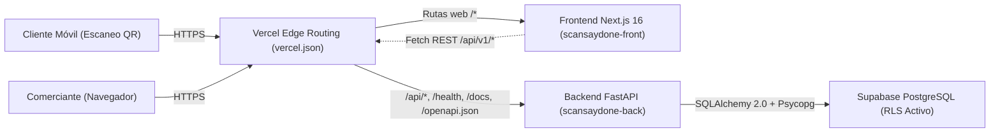
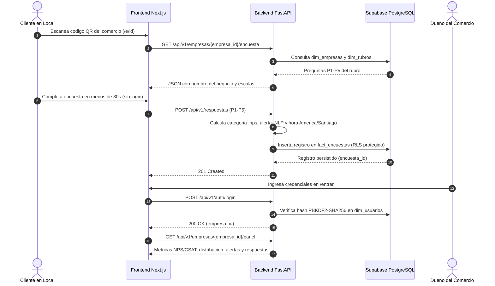

<div align="center">


<h3>Plataforma ágil de encuestas de satisfacción y analítica NPS/CSAT en tiempo real mediante códigos QR para MiPymes y pequeños comercios.</h3>

<p>
  <strong>«Escucha antes del reclamo»</strong> · Desarrollado por <strong>Dunk &amp; Code XD</strong> en el marco de <strong>Proyectos Colaborativos — Talento Digital Chile 2026</strong>.
</p>

<p>
  <a href="https://github.com/DunkandCode/ScanSayDone/actions/workflows/ci.yml">
    
  </a>
  <a href="https://scansaydone.vercel.app">
    
  </a>
  
  
  
  
  
</p>

<p>
  <a href="https://scansaydone.vercel.app"><strong>🌐 Aplicación en Vivo</strong></a> ·
  <a href="https://scansaydone.vercel.app/docs"><strong>📚 API Swagger</strong></a> ·
  <a href="https://scansaydone.vercel.app/health"><strong>🩺 Estado API</strong></a> ·
  <a href="https://github.com/orgs/DunkandCode/projects/1"><strong>📋 Tablero Kanban</strong></a> ·
  <a href="#-equipo-dunk--code-xd"><strong>👥 Equipo y Roles</strong></a> ·
  <a href="#-puesta-en-marcha-local"><strong>🚀 Guía Local</strong></a>
</p>

</div>

---

## 📑 Tabla de Contenidos

1. [Problema y Propuesta de Valor](#-problema-y-propuesta-de-valor)
2. [Entornos y Enlaces en Vivo](#-entornos-y-enlaces-en-vivo)
3. [Arquitectura del Sistema y Flujo de Datos](#-arquitectura-del-sistema-y-flujo-de-datos)
4. [Modelo de Encuesta, Rubros y Motor Analítico](#-modelo-de-encuesta-rubros-y-motor-analítico)
5. [Superficies Web y Endpoints de la API](#-superficies-web-y-endpoints-de-la-api)
6. [Estructura del Monorepo](#-estructura-del-monorepo)
7. [Puesta en Marcha Local](#-puesta-en-marcha-local)
8. [Seguridad, CI/CD y Despliegue](#-seguridad-cicd-y-despliegue)
9. [Centro de Documentación](#-centro-de-documentación)
10. [Equipo Dunk & Code XD](#-equipo-dunk--code-xd)
11. [Flujo de Trabajo y Contribución](#-flujo-de-trabajo-y-contribución)

---

## 💡 Problema y Propuesta de Valor

### El Problema
Los pequeños comercios (cafeterías, minimarkets, peluquerías y emprendimientos digitales) rara vez cuentan con herramientas simples para medir la experiencia de sus clientes en el instante en que ocurre el servicio:
- **El 96 % de los clientes insatisfechos no reclama al dueño:** simplemente deja de volver o publica una reseña negativa en Google Maps o redes sociales.
- **Las encuestas tradicionales generan fricción:** correos posteriores, formularios extensos o solicitudes de registro obtienen tasas de respuesta inferiores al 2 %.

### La Solución: **ScanSayDone** (*Escanea · Opina · Listo*)
Un sistema diseñado bajo tres principios rectores:

| Pilar | Cómo lo resolvemos en ScanSayDone |
| :--- | :--- |
| **⚡ Cero fricción (< 30 s)** | El cliente escanea el código QR impreso en mesa, caja o boleta con la cámara de su celular y responde **5 preguntas breves sin crear cuenta ni iniciar sesión**. |
| **📊 Inteligencia accionable** | El servidor clasifica automáticamente cada respuesta (**Promotor / Pasivo / Detractor**), calcula **NPS**, **CSAT** y **Top Box** por atributo, clasifica comentarios abiertos mediante **NLP léxico** y levanta **alertas tempranas** ante notas críticas (`P1 ≤ 6` o `P2 ≤ 2`). |
| **🛡️ Privacidad por diseño** | Encuestas anónimas sin solicitud de RUT, teléfono ni datos bancarios. Toda la persistencia vive detrás de **FastAPI** con **Row Level Security (RLS)** habilitado en todas las tablas de **Supabase PostgreSQL**. |

---

## 🌐 Entornos y Enlaces en Vivo

Frontend y Backend se despliegan unificados bajo un mismo dominio gracias a **Vercel Services** ([`vercel.json`](vercel.json)), en la región **`gru1` (São Paulo)** para baja latencia en Chile y Latinoamérica.

| Recurso | URL / Ubicación | Estado Actual |
| :--- | :--- | :--- |
| **Aplicación Web (Landing, Acceso y Panel)** | [`scansaydone.vercel.app`](https://scansaydone.vercel.app) | 🟢 En producción (`/` landing, `/entrar`, `/panel` demo) |
| **Documentación Interactiva API (Swagger UI)** | [`scansaydone.vercel.app/docs`](https://scansaydone.vercel.app/docs) | 🟢 Operativa con esquema OpenAPI 3 |
| **Healthcheck del Backend** | [`scansaydone.vercel.app/health`](https://scansaydone.vercel.app/health) | 🟢 Responde `{"status":"ok","version":...}` |
| **Esquema OpenAPI JSON** | [`scansaydone.vercel.app/openapi.json`](https://scansaydone.vercel.app/openapi.json) | 🟢 Operativo |
| **Encuesta QR Móvil (`/e/[code]`)** | [`scansaydone.vercel.app/e/2`](https://scansaydone.vercel.app/e/2) | 🟡 Marcador en integración con API (`#14`, contrato backend listo) |
| **Tablero Kanban y Sprints** | [GitHub Projects — ScanSayDone](https://github.com/orgs/DunkandCode/projects/1) | 🟢 Activo |

> **Nota sobre integración en curso:** La API REST del backend (`POST /api/v1/respuestas`, `POST /api/v1/auth/login`, `GET /api/v1/empresas/{empresa_id}/panel` y `GET /api/v1/empresas/{empresa_id}/encuesta`) ya está desplegada y conectada a **Supabase** con **80 encuestas de demostración** cargadas. Actualmente el equipo frontend integra las vistas `/e/[code]` y `/panel` para consumir estos endpoints en reemplazo del dataset demo estático.

---

## 🏛️ Arquitectura del Sistema y Flujo de Datos

### Enrutamiento Unificado (Monorepo + Vercel Services)

El repositorio mantiene desacopladas las aplicaciones de frontend y backend dentro de un mismo monorepo, pero las expone bajo un origen único en producción para evitar problemas de CORS entre dominios y simplificar los enlaces relativos (`/api/v1/...`).



### Flujo de Extremo a Extremo (Encuesta QR y Panel de Gestión)



### Stack Tecnológico

| Capa | Tecnologías Principales | Propósito en el Proyecto |
| :--- | :--- | :--- |
| **Frontend Web** | **Next.js `16.4.3`** (App Router, Turbopack), **React `19.3`**, **TypeScript 5**, **Tailwind CSS 4** | Landing comercial, portal de acceso (`/entrar`), panel de resultados (`/panel`) y encuesta móvil QR (`/e/[code]`). |
| **Backend API** | **Python 3.11** (compatible 3.10+), **FastAPI `0.115+`**, **Pydantic `2.8+`**, **Uvicorn**, **QRCode (`Pillow`)** | Endpoints REST, validación estricta de entradas, generación dinámica de códigos QR en PNG, motor de reglas NPS/CSAT y NLP léxico. |
| **Datos & Persistencia** | **PostgreSQL (Supabase)**, **SQLAlchemy 2.0**, **Alembic**, **Psycopg 3**, **`tzdata` (`America/Santiago`)** | Esquema dimensional (`dim_rubros`, `dim_empresas`, `dim_usuarios`, `fact_encuestas`), migraciones versionadas, RLS y cortes horarios de Chile. |
| **Analítica & Validación** | **Python**, **`openpyxl`**, **Streamlit + Plotly** *(sandbox interno en `docs/datos/`)* | Pipeline léxico de clasificación de comentarios, generación del dataset sintético de 80 encuestas y prototipo analítico. |
| **Calidad & Testing** | **Pytest**, **HTTPX**, **Vitest**, **Testing Library**, **Playwright + `@axe-core/playwright`**, **ESLint 9** | 149 pruebas unitarias/integración backend (SQLite en memoria), 145 pruebas frontend y auditoría automatizada de accesibilidad (desktop y móvil). |
| **Infraestructura & CI/CD** | **Vercel Services**, **GitHub Actions**, **GitHub Projects** | Despliegue unificado en región `gru1`, compilación Next.js, suite pytest y auditoría de secretos `.env` en cada push/PR. |

---

## 🧩 Modelo de Encuesta, Rubros y Motor Analítico

Toda la lógica metodológica y estadística está unificada entre el área de **Datos** ([`docs/datos/`](docs/datos/README.md)) y el **Backend** ([`scansaydone-back/scansaydone/`](scansaydone-back/README.md)).

### Estructura Estandarizada de 5 Preguntas
1. **P1 — NPS (`0–10`):** *"¿Qué tan probable es que recomiendes el negocio a un amigo o familiar?"*
   - Clasificación servidor: **Promotor** (`9–10`), **Pasivo** (`7–8`), **Detractor** (`0–6`).
   - Fórmula NPS: `% Promotores − % Detractores`.
2. **P2 — CSAT Satisfacción Global (`1–5`):** *"En general, ¿qué tan satisfecho/a quedaste?"*
   - Fórmula CSAT: `% de respuestas con nota 4 o 5`.
3. **P3 y P4 — Atributos Críticos por Rubro (`1–5`):** Evaluaciones adaptadas al giro del negocio y medidas por media y *Top Box* (`% en 4 o 5`).
4. **P5 — Comentario Abierto Opcional (`≤ 300` caracteres):** Clasificado automáticamente en servidor vía [`nlp.py`](scansaydone-back/scansaydone/nlp.py) en `Felicitación`, `Reclamo`, `Sugerencia / mixto` o `Sin comentario`.

### Catálogo de Rubros y Negocios de Demostración (Base Actual en Supabase)

| `empresa_id` | Negocio Demo | Rubro (`dim_rubros`) | Atributos P3 / P4 | Usuario Demo (`dim_usuarios`) |
| :---: | :--- | :--- | :--- | :--- |
| **1** | **Minimarket Don Lucho** | Minimarket / almacén de barrio | Surtido y disponibilidad · Calidad de la atención | `minimarket_don_lucho` |
| **2** | **Café Rincón Andino** | Cafetería / restaurante | Calidad del producto · Tiempo de servicio | `cafe_rincon_andino` |
| **3** | **Peluquería Estilo Sur** | Peluquería / centro de estética | Calidad técnica del servicio · Comunicación y personalización | `peluqueria_estilo_sur` |
| **4** | **Cosmos Accesorios (Instagram)** | Emprendimiento de venta online | Calidad y expectativa del producto · Cumplimiento logístico | `cosmos_accesorios` |

> Cada negocio cuenta con **20 encuestas simuladas (80 en total)** importadas de forma idempotente desde [`simulacion_80_encuestas.xlsx`](docs/datos/datasets/simulacion_80_encuestas.xlsx). Además, toda respuesta con `P1 ≤ 6` o `P2 ≤ 2` dispara la marca **`ALERTA`** en tiempo real con timestamp convertido a zona horaria **`America/Santiago`** (`Mañana`, `Tarde`, `Noche`).

---

## 🔌 Superficies Web y Endpoints de la API

### Rutas del Frontend (`scansaydone-front/src/app/`)

| Ruta | Grupo | Propósito | Estado |
| :--- | :--- | :--- | :--- |
| `/` | `(marketing)` | Landing principal (propuesta de valor, funcionamiento, canales, aplicaciones y FAQ) | ✅ Operativa |
| `/services`, `/pricing`, `/aboutus`, `/contactus`, `/faqs`, `/privacy`, `/terms` | `(marketing)` | Páginas informativas, planes y políticas legales | ✅ Operativas |
| `/entrar` | `(auth)` | Pantalla de acceso para comerciantes | ✅ UI lista (pendiente enlazar sesión) |
| `/panel` | `(panel)` | Dashboard con KPIs, evolución 30 días, distribución y últimas respuestas | 🟡 Demo estático (`panel-data.ts`) |
| `/e/[code]` | `(survey)` | Encuesta móvil QR para clientes finales | 🟡 Marcador (integración en `#14`) |

### Endpoints de la API REST (`scansaydone-back/`)

| Método | Ruta | Descripción | Autenticación |
| :---: | :--- | :--- | :---: |
| `GET` | `/` | Metadatos del servicio (`ScanSayDone API`, estado `online`) | Pública |
| `GET` | `/health` | Chequeo de salud y versión del backend | Pública |
| `GET` | `/api/v1/qr/generate?target_url=...` | Genera código QR en formato `image/png` (`box_size`, `border` configurables) | Pública |
| `POST` | `/api/v1/nps/calculate` | Calcula score NPS, conteos y categoría a partir de una lista `[0..10]` | Pública |
| `GET` | `/api/v1/empresas/{empresa_id}/encuesta` | Devuelve nombre, rubro y textos exactos de P1–P5 para construir la encuesta | Pública |
| `POST` | `/api/v1/respuestas` | Registra respuesta anónima (`201 Created`); deriva NPS, alerta, NLP y fecha Chile | Pública |
| `POST` | `/api/v1/auth/login` | Login de demostración con verificación `PBKDF2-SHA256` (`dim_usuarios`) | Pública |
| `GET` | `/api/v1/empresas/{empresa_id}/panel` | Agregado completo (NPS, CSAT, `p3`/`p4`, distribución `0–10`, serie diaria) + detalle | Demo (`empresa_id`) |

> Consulta los esquemas JSON exactos, códigos de error (`401`, `404`, `422`, `503`) e invariantes en el contrato oficial: [`CONTRATO-API-BACKEND-2026-11-19-JPA.md`](docs/integracion/CONTRATO-API-BACKEND-2026-11-19-JPA.md).

---

## 📁 Estructura del Monorepo

```text
ScanSayDone/
├── .github/workflows/
│   └── ci.yml                          # Pipeline CI: Next.js build, Pytest y auditoría de secretos (.env)
├── vercel.json                         # Configuración unificada de Vercel Services (frontend + backend en gru1)
├── README.md                           # Este documento
│
├── assets/marca/                       # Identidad visual oficial (logotipos fuente + MANIFEST-ASSETS.md)
│
├── scansaydone-front/                  # [FRONTEND] Next.js 16 + React 19 + TypeScript + Tailwind CSS 4
│   ├── src/
│   │   ├── app/                        # App Router: (marketing), (auth)/entrar, (panel)/panel, (survey)/e/[code]
│   │   ├── components/                 # Componentes por dominio (auth, chrome, marketing, panel)
│   │   └── lib/                        # Configuración y copy centralizado
│   ├── public/img/                     # Activos servidos (fondos, ilustraciones, marca Dunk & Code XD)
│   ├── tests/                          # Pruebas de accesibilidad Playwright + axe-core
│   ├── dev-saydone.bat                 # Utilidad de gestión segura de puertos en Windows
│   └── package.json                    # Scripts de dev, build, lint, vitest y test:a11y
│
├── scansaydone-back/                   # [BACKEND] Python 3.11 + FastAPI + SQLAlchemy 2.0 + Alembic
│   ├── main.py                         # Inicialización FastAPI, CORS y manejador seguro 503
│   ├── scansaydone/
│   │   ├── routers/                    # Endpoints: general, qr, analytics, respuestas, empresas, auth
│   │   ├── models.py                   # Modelos ORM (dim_rubros, dim_empresas, fact_encuestas, dim_usuarios)
│   │   ├── schemas.py                  # Esquemas Pydantic con validación estricta (sin coerción laxa)
│   │   ├── catalogo.py                 # Catálogo oficial de preguntas P1-P5 por rubro
│   │   ├── reglas.py                   # Clasificación NPS, alertas y zona horaria America/Santiago
│   │   ├── nlp.py                      # Clasificador léxico de comentarios (espejo del pipeline de datos)
│   │   ├── panel.py                    # Agregador de métricas del dashboard (NPS, CSAT, Top Box, series)
│   │   ├── seguridad.py                # Hashing de contraseñas PBKDF2-SHA256
│   │   ├── registro.py / simulacion.py # Construcción de registros y carga idempotente desde Excel
│   │   ├── config.py / db.py           # Gestión de entorno, CORS y sesión SQLAlchemy bajo demanda
│   │   └── demo.py / usuarios_demo.py  # Datos base y generador de credenciales demo
│   ├── alembic/versions/               # Migraciones PostgreSQL + activación automática de RLS
│   ├── scripts/                        # seed_demo.py, cargar_simulacion.py, usuarios_demo.py
│   ├── tests/                          # Suite Pytest (149 pruebas en memoria con SQLite)
│   ├── .env.example                    # Plantilla de variables de entorno (nunca subir .env reales)
│   ├── requirements.txt                # Dependencias de producción para Vercel
│   └── requirements-dev.txt            # Dependencias de desarrollo y pruebas
│
└── docs/                               # [CENTRO DE DOCUMENTACIÓN]
    ├── equipo-dunk-code-xd.png         # Ficha oficial del equipo — Talento Digital Chile
    ├── manual_de_inicio_rapido.md      # Onboarding paso a paso en 5 minutos
    ├── arquitectura/                   # Visión del producto y arquitectura del sistema
    ├── datos/                          # Metodología NPS, ERD, dataset (80 encuestas) y scripts NLP/Streamlit
    ├── frontend/                       # UX specs, planos por breakpoint, decisiones y wireframes SVG/PNG
    ├── implementaciones/               # Plan maestro del MVP por fases
    ├── instrucciones/                  # Protocolo de reuniones semanales (30-30-30)
    ├── integracion/                    # Contratos API Frontend ↔ Backend y acuerdos técnicos
    ├── operaciones/                    # Operación segura de servidores locales de desarrollo
    ├── planning/                       # Planes técnicos de frontend
    ├── reuniones/                      # Minutas y pautas de reunión
    ├── roles/                          # Matriz de asignación y guías prácticas por especialidad (00–05)
    ├── sprints/                        # Pautas de sprint y acuerdos
    └── superpowers/                    # Diseños y planes técnicos detallados del backend
```

---

## 🚀 Puesta en Marcha Local

### Prerrequisitos
- **Git** (`git --version`)
- **Node.js 20+** y `npm`
- **Python 3.11+** (compatible desde Python 3.10)

### 1. Clonar el repositorio

```bash
git clone https://github.com/DunkandCode/ScanSayDone.git
cd ScanSayDone
```

### 2. Levantar el Frontend (`scansaydone-front/`)

```bash
cd scansaydone-front
npm install
npm run dev
```
Accede en tu navegador a [`http://localhost:3000`](http://localhost:3000).  
*(En Windows también puedes usar `dev-saydone.bat` o `npm run servers:list` / `servers:stop` para evitar puertos bloqueados; revisa [`DEV-SERVERS-2026-11-07.md`](docs/operaciones/DEV-SERVERS-2026-11-07.md)).*

### 3. Levantar el Backend (`scansaydone-back/`)

**En Linux / macOS:**
```bash
cd scansaydone-back
python3 -m venv venv
source venv/bin/activate
pip install -r requirements-dev.txt
```

**En Windows (PowerShell):**
```powershell
cd scansaydone-back
python -m venv venv
.\venv\Scripts\Activate.ps1
pip install -r requirements-dev.txt
```

Configura las variables de entorno copiando la plantilla (el archivo `.env` está bloqueado en `.gitignore`; **nunca lo subas al repositorio**):

```bash
cp .env.example .env
```

Variables soportadas ([`.env.example`](scansaydone-back/.env.example)):
- `POSTGRES_URL` — cadena de conexión del pooler de Supabase (aplicación).
- `POSTGRES_URL_NON_POOLING` — conexión directa para ejecutar migraciones Alembic.
- `DATABASE_URL` — opcional, tiene prioridad sobre `POSTGRES_URL`.
- `ALLOWED_ORIGINS` / `ALLOWED_ORIGIN_REGEX` — orígenes CORS permitidos (por defecto `http://localhost:3000` y `https://scansaydone.vercel.app`).

Con la base de datos conectada, ejecuta migraciones, seed y servidor local:

```bash
alembic upgrade head                       # Crea tablas, rubros y activa RLS en PostgreSQL
python scripts/seed_demo.py                # Siembra los 4 negocios de demostración
python scripts/cargar_simulacion.py        # Importa las 80 encuestas simuladas (#16)
uvicorn main:app --reload                  # Levanta API en http://localhost:8000/docs
```

### 4. Comandos de Pruebas y Calidad

| Área | Comando (dentro de su carpeta) | Qué valida |
| :--- | :--- | :--- |
| **Backend Tests** | `python -m pytest -v` | 149 pruebas unitarias/integración con SQLite en memoria (no requiere Supabase) |
| **Backend Sintaxis** | `python -m py_compile main.py` | Validación sintáctica de entrada API |
| **Frontend Lint** | `npm run lint` | Reglas ESLint 9 + Next.js |
| **Frontend Unit** | `npm test` | Suite Vitest + Testing Library (145 pruebas) |
| **Frontend Build** | `npm run build` | Compilación de producción Next.js |
| **Accesibilidad (a11y)** | `npm run test:a11y` | Build + servidor en `127.0.0.1:3120` + Playwright & `axe-core` (1440px y 375px) |

---

## 🛡️ Seguridad, CI/CD y Despliegue

### Integración Continua (GitHub Actions)
Cada push a `main`, `dev/**`, `feat/**` y cada Pull Request hacia `main` ejecuta automáticamente los 3 jobs de [`.github/workflows/ci.yml`](.github/workflows/ci.yml):
1. **🌐 `frontend-build`:** Instala dependencias limpias (`npm ci`) y verifica compilación de producción (`npm run build`) en Node 20.
2. **⚙️ `backend-test`:** Instala `requirements-dev.txt` en Python 3.11, valida `main.py` y ejecuta toda la suite `pytest -v`.
3. **🛡️ `security-audit`:** Escanea el árbol del repositorio y falla inmediatamente el pipeline si detecta cualquier archivo `*.env` rastreado fuera de `.git/`.

### Controles de Seguridad Implementados y en Curso
- **Row Level Security (RLS) estricto:** Las migraciones [`0001_tablas_iniciales.py`](scansaydone-back/alembic/versions/0001_tablas_iniciales.py) y [`0002_usuarios.py`](scansaydone-back/alembic/versions/0002_usuarios.py) habilitan RLS en todas las tablas (`dim_rubros`, `dim_empresas`, `fact_encuestas`, `dim_usuarios`, `alembic_version`) sin políticas públicas, impidiendo acceso directo desde la API pública (`anon`) de Supabase.
- **Validación estricta en API:** Esquemas Pydantic sin coerción laxa de tipos ni campos extra; restricciones `CHECK` a nivel de base de datos.
- **Manejo seguro de errores:** Errores de BD retornan `503` genérico al cliente mientras el detalle técnico queda aislado en logs internos sin exponer credenciales.
- **En progreso (`#15`):** Rate limiting por IP en `POST /api/v1/respuestas` y sanitización reforzada para entorno *serverless*.

### Despliegue en Producción (Vercel)
El archivo raíz [`vercel.json`](vercel.json) define los dos servicios (`scansaydone-front/` y `scansaydone-back/`). En la configuración del proyecto en Vercel Dashboard, **Root Directory debe permanecer vacío (raíz del repositorio)** para que Vercel Services construya ambos servicios y aplique los *rewrites* correctamente.

---

## 📚 Centro de Documentación

| Categoría | Documentos Clave |
| :--- | :--- |
| **Arquitectura y Visión** | [`vision_y_arquitectura.md`](docs/arquitectura/vision_y_arquitectura.md) · [`plan_maestro_mvp_scansaydone.md`](docs/implementaciones/plan_maestro_mvp_scansaydone.md) |
| **Backend & Contratos API** | [`scansaydone-back/README.md`](scansaydone-back/README.md) · [`CONTRATO-API-BACKEND-2026-11-19-JPA.md`](docs/integracion/CONTRATO-API-BACKEND-2026-11-19-JPA.md) · [`BACKEND-LOGIN-Y-PANEL-2026-11-18.md`](docs/integracion/BACKEND-LOGIN-Y-PANEL-2026-11-18.md) |
| **Frontend, UX y Planos** | [`docs/frontend/README.md`](docs/frontend/README.md) · [`CANON.md`](docs/frontend/CANON.md) · [`INDEX.md`](docs/frontend/INDEX.md) · [`MANIFEST-ASSETS.md`](assets/marca/MANIFEST-ASSETS.md) |
| **Analítica & Datos** | [`docs/datos/README.md`](docs/datos/README.md) · [`pipeline_nlp_y_metricas.py`](docs/datos/scripts_analitica/pipeline_nlp_y_metricas.py) · [`dashboard_streamlit.py`](docs/datos/scripts_analitica/dashboard_streamlit.py) |
| **Onboarding y Operación** | [`manual_de_inicio_rapido.md`](docs/manual_de_inicio_rapido.md) · [`DEV-SERVERS-2026-11-07.md`](docs/operaciones/DEV-SERVERS-2026-11-07.md) · [`protocolo_reunion_miercoles.md`](docs/instrucciones/protocolo_reunion_miercoles.md) |
| **Reuniones y Sprints** | [`reunion_2026-10-22_notas.md`](docs/reuniones/reunion_2026-10-22_notas.md) · [`pauta_sprint_3.md`](docs/sprints/pauta_sprint_3.md) · [`pauta_reunion_2026-11-11_2100.md`](docs/reuniones/pauta_reunion_2026-11-11_2100.md) · [`pauta_reunion_2026-11-18.md`](docs/reuniones/pauta_reunion_2026-11-18.md) |

---

## 👥 Equipo Dunk & Code XD

> **Nuestro lema:** *"Encestamos código, anotamos soluciones"*  
> **Lo que aportamos:** *"Contamos la historia del proyecto con claridad y convicción, conectando el problema, la solución y el impacto."* — ([Ficha oficial del equipo](docs/equipo-dunk-code-xd.png))

La distribución detallada de responsabilidades, usuarios de Discord y roles de apoyo se mantiene en:  
👉 **[Matriz de Roles del Equipo](docs/roles/MATRIZ_EQUIPO_Y_ROLES.md)**

### Integrantes del Equipo

| Integrante | Área / Rol Principal | GitHub | Guía de Especialidad |
| :--- | :--- | :--- | :--- |
| **Daniel García Rojas** | 🎯 Product Manager / Coordinador & 🛡️ Ciberseguridad / QA / CI-CD | [`@DGRcodex`](https://github.com/DGRcodex) | [PM](docs/roles/00_product_manager.md) · [Ciberseguridad](docs/roles/05_ciberseguridad.md) |
| **Nicolás López Vásquez** | 💻 Ingeniería Frontend Principal (`scansaydone-front`) & 🎯 Coordinación Suplente | [`@nicolaslopezv`](https://github.com/nicolaslopezv) | [Desarrollo Frontend](docs/roles/01_frontend.md) · [PM](docs/roles/00_product_manager.md) |
| **Juan Pablo Ahumada** | ⚙️ Ingeniería Backend Principal (`scansaydone-back`), 🛡️ Ciberseguridad (RLS/API), 📊 Apoyo Datos & 🎯 Coordinación Suplente | [`@JuampaCL`](https://github.com/JuampaCL) | [Backend](docs/roles/02_backend.md) · [Ciberseguridad](docs/roles/05_ciberseguridad.md) · [PM](docs/roles/00_product_manager.md) |
| **Bernarda Rodríguez** | 📊 Especialista de Datos, Metodología NPS, Validación & 🎯 Coordinación Suplente | [`@bernarda2020163`](https://github.com/bernarda2020163) | [Datos & NPS](docs/roles/03_datos.md) · [PM](docs/roles/00_product_manager.md) |
| **Thomas Rain** | 🎨 Diseño UX / UI & Wireframes | [`@thomasrain05-design`](https://github.com/thomasrain05-design) | [Diseño UX / UI](docs/roles/04_ux_ui.md) |
| **Adrián** *(`[Apellido por confirmar]`)* | 🎨 Diseño UX / UI | [`@adrianoux8`](https://github.com/adrianoux8) | [Diseño UX / UI](docs/roles/04_ux_ui.md) |
| **Fabiana Cueto** | 📢 Validación Comercial & Comercios Piloto | `[Por confirmar]` | [UX / Pilotos](docs/roles/04_ux_ui.md) |
| **Sebastián Riveros** | 🤝 Integrante Dunk & Code XD *(rol específico por confirmar)* | `[Por confirmar]` | [Matriz de Roles](docs/roles/MATRIZ_EQUIPO_Y_ROLES.md) |

### Asignación por Guía de Rol

| Especialidad | Guía de Inicio Rápido | Responsables Asignados | Estado |
| :--- | :--- | :--- | :---: |
| 🎯 **Product Manager & Scrum** | [Guía de PM y Coordinación](docs/roles/00_product_manager.md) | **Daniel García Rojas** (`@DGRcodex`) · *Suplentes: Nicolás López (`@nicolaslopezv`), Bernarda Rodríguez (`@bernarda2020163`) y Juan Pablo Ahumada (`@JuampaCL`)* | ✅ Asignado |
| 💻 **Ingeniería Frontend** | [Guía de Desarrollo Frontend](docs/roles/01_frontend.md) | **Nicolás López Vásquez** (`@nicolaslopezv`) | ✅ Asignado |
| ⚙️ **Ingeniería Backend** | [Guía de Desarrollo Backend](docs/roles/02_backend.md) | **Juan Pablo Ahumada** (`@JuampaCL`) · *Apoyo Infra: Daniel García* | ✅ Asignado |
| 📊 **Analítica & Datos** | [Guía de Datos & NPS](docs/roles/03_datos.md) | **Bernarda Rodríguez** (`@bernarda2020163`) · *Apoyo ERD: Juan Pablo Ahumada* | ✅ Asignado |
| 🎨 **Diseño UX / UI** | [Guía de UX / UI](docs/roles/04_ux_ui.md) | **Thomas Rain** (`@thomasrain05-design`) · **Adrián** (`@adrianoux8`) · *Pilotos: Fabiana Cueto* | ✅ Asignado |
| 🛡️ **Ciberseguridad & QA** | [Guía de Ciberseguridad](docs/roles/05_ciberseguridad.md) | **Daniel García Rojas** (`@DGRcodex`) · **Juan Pablo Ahumada** (`@JuampaCL`) | ✅ Asignado |

---

## 🌿 Flujo de Trabajo y Contribución

1. **Rama `main` protegida:** Todo cambio entra vía Pull Request con verificación previa de CI (`frontend-build`, `backend-test`, `security-audit`).
2. **Convención de ramas:** Trabaja en tu rama (`dev/<usuario>` o `feat/<descripcion>`) partiendo de `origin/main` actualizado.
3. **Trazabilidad en Issues:** Vincula cada PR al tablero indicando `Closes #<numero-issue>` en la descripción.
4. **Reuniones semanales:** Todos los miércoles bajo la dinámica **30-30-30** (*Review & Retro / Alineación Técnica / Planning*) documentada en [`protocolo_reunion_miercoles.md`](docs/instrucciones/protocolo_reunion_miercoles.md).
5. **Onboarding:** Revisa el [**Manual de Inicio Rápido en 5 minutos**](docs/manual_de_inicio_rapido.md) antes de tu primer commit.

---

<div align="center">
  <sub>Construido con dedicación por <strong>Dunk &amp; Code XD</strong> · Programa Colabora TD 2026 — Talento Digital para Chile</sub>
</div>
