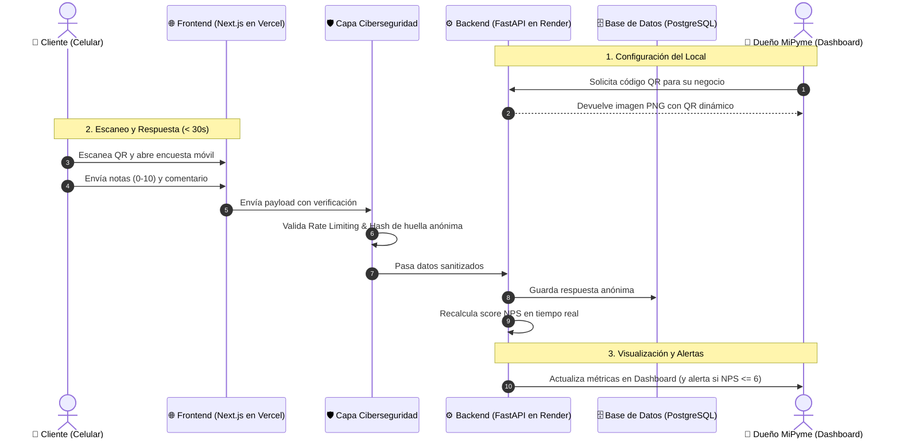

# 🏛️ Visión del Producto y Arquitectura del Sistema
## ScanSayDone — Dunk & Code XD | Talento Digital 2026

> **"Escucha antes del reclamo":** Plataforma ágil de encuestas de satisfacción y medición de NPS en tiempo real mediante códigos QR para MiPymes y pequeños comercios.

---

## 💡 1. El Problema y la Propuesta de Valor

### El Problema
Los pequeños comercios (cafeterías, restaurantes, minimarkets, peluquerías) carecen de mecanismos simples para medir la satisfacción de sus clientes en el momento del consumo. Cuando un cliente tiene una mala experiencia:
- El 96% no reclama directamente al dueño: simplemente no vuelve o publica una mala reseña en Google / redes sociales.
- Las soluciones tradicionales (encuestas por correo o códigos QR con formularios interminables de Google Forms) tienen tasas de respuesta inferiores al 2% porque son lentas y piden registrarse.

### La Solución: ScanSayDone
Un flujo ultra veloz pensado para el celular:
1. El comercio imprime su código QR y lo pone en la mesa, mostrador o boleta.
2. El cliente escanea el QR con su cámara nativa.
3. **En menos de 30 segundos y sin registrarse**, responde 3 preguntas simples de satisfacción (NPS + 2 preguntas clave) y un comentario opcional.
4. El dueño del local recibe alertas ante evaluaciones negativas inmediatamente para intervenir a tiempo, y visualiza en su panel un semáforo de satisfacción en tiempo real.

---

## 🏗️ 2. Arquitectura Técnica del Monorepo

El proyecto está organizado como un **Monorepo** para mantener frontend y backend versionados juntos, pero desplegados de forma desacoplada:

```text
ScanSayDone/
├── scansaydone-front/        # [FRONTEND] Web App Next.js 16 + Tailwind CSS (Vercel)
│   ├── src/app/              # App Router (Páginas de encuesta y dashboard)
│   ├── public/               # Íconos y recursos estáticos
│   └── package.json          # Dependencias React/Next.js
│
├── scansaydone-back/         # [BACKEND] API REST FastAPI + Python 3.10+ (Render/Railway)
│   ├── main.py               # Servidor FastAPI, endpoints QR, NPS y salud
│   └── requirements.txt      # Dependencias Python (FastAPI, Uvicorn, QRCode, Pydantic)
│
└── docs/                     # [DOCUMENTACIÓN]
    ├── arquitectura/         # Especificaciones del sistema y flujos
    ├── roles/                # Guías de trabajo para cada integrante del equipo
    └── instrucciones/        # Manuales de Sprints, Product Manager y Vercel
```

---

## 🔄 3. Flujo de Datos de Extremo a Extremo



---

## 🚀 4. Estado Actual del Desarrollo (¿Qué está listo?)

| Componente | Estado | Qué incluye |
| :--- | :---: | :--- |
| **Frontend Base** | ✅ **Listo** | Next.js 16 (App Router), TypeScript, Tailwind CSS, Turbopack, compilación testeada sin errores. Listo para desplegar en Vercel. |
| **Backend Base** | ✅ **Listo** | FastAPI, CORS habilitado, endpoint `/health`, generador de QR en PNG (`/api/v1/qr/generate`), y motor de cálculo de NPS (`/api/v1/nps/calculate`). |
| **Estructura Git & CI** | ✅ **Listo** | Repositorio público, `.gitignore` exhaustivo (bloquea `.env` y cachés), commits protegidos. |
| **Tablero de Sprints** | ✅ **Listo** | GitHub Projects público con 11 tareas iniciales organizadas por roles y Sprint 2 activo. |
| **Documentación** | ✅ **Listo** | Manuales de PM, protocolo de reuniones 30-30-30 y guías por rol. |

---

## 🎯 5. Siguientes Pasos Inmediatos para el Equipo
1. **Asignación de Roles:** El PM y el equipo definen quién asume cada área en la [Matriz de Roles](../roles/MATRIZ_EQUIPO_Y_ROLES.md).
2. **Reunión del Miércoles:** Revisar las tareas del Sprint 2 y autoasignarse los Issues en [GitHub Projects](https://github.com/orgs/DunkandCode/projects/1).
3. **Inicio de Desarrollo:** Cada área sigue su respectiva guía técnica en `docs/roles/`.
