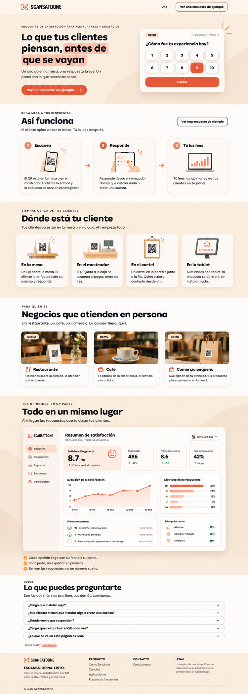

# Scan-Say-Done — Guía de rediseño UX/UI de la landing page

> **Documento de especificación visual y funcional — versión 1.0**  
> **Proyecto:** Scan-Say-Done  
> **Objetivo:** transformar la landing actual en una experiencia SaaS más profesional, atractiva y fácil de entender, **manteniendo la estructura, los mensajes fundamentales y el recorrido actual**.  
> **Alcance:** diseño de landing pública, vistas de demostración y recursos gráficos. No supone una reescritura del producto ni la implementación de nuevas funcionalidades del backend.



**Aviso sobre la referencia:** la imagen es una **maqueta de dirección de arte**, no una captura funcional. Los textos, las métricas y los elementos de los gráficos ilustran cómo podría verse el producto. Antes de publicarla debe corregirse cualquier error de texto generado en la imagen (en particular, escribir la marca siempre como **Scan-Say-Done**) y reemplazar los recursos ilustrativos por componentes reales e imágenes propias.

---

## 1. Resumen de la propuesta

El rediseño mantiene ocho bloques, en este orden:

1. Navegación principal.
2. Hero con propuesta de valor y encuesta interactiva de ejemplo.
3. **Así funciona:** escanea → responde → tú las lees.
4. **Dónde está tu cliente:** mesa, mostrador, cartel, tablet.
5. **Negocios que atienden en persona:** restaurante, café, comercio pequeño.
6. **Todo en un mismo lugar:** vista previa del dashboard de satisfacción.
7. Preguntas frecuentes.
8. Pie de página.

**Principio principal:** **no eliminar secciones ni alterar el flujo comercial de la landing**. La mejora debe centrarse en claridad de lectura, identidad visual, jerarquías, gráficos, fotografías, coherencia de tarjetas y diseño adaptable.

### Qué debe mejorar

- La landing original utiliza bastante espacio vacío y varias áreas con el mensaje «Todavía no hay foto/panel que mostrar». Esos espacios deben convertirse en **recursos visuales diseñados específicamente para explicar el servicio**.
- El usuario debe entender en pocos segundos **qué es el producto, cómo funciona con QR y qué recibe en su panel de reportes**.
- El CTA «Ver una encuesta de ejemplo» debe tener prioridad visual y llevar a una demostración real; el dashboard es un segundo punto de demostración importante.
- La interfaz debe conservar una estética cercana y cálida, adecuada para emprendimientos y pymes, sin parecer un sitio de banca, un ERP o un portal estatal.
- Las fotografías y las ilustraciones deben tener una **misma dirección artística** y no parecer imágenes pegadas de distintas fuentes.

### Qué no debe cambiar

- El nombre del producto: **Scan-Say-Done** (usar el logotipo oficial aprobado cuando esté disponible).
- La idea de encuestas de satisfacción accesibles a través de QR, sin instalar aplicaciones para responder.
- El orden y la intención de todas las secciones existentes.
- Las categorías de uso actuales: mesa, mostrador, cartel y tablet; restaurante, café y comercio pequeño.
- El lenguaje cercano, directo y comprensible para propietarios de pequeños negocios.

---

## 2. Sistema visual y dirección de arte

### 2.1. Personalidad del diseño

- **Cercano:** colores cálidos, textos simples y ejemplos reales de negocios.
- **Confiable:** gráficos claros, alineaciones precisas y presentación ordenada de datos.
- **Moderno:** tarjetas suaves, iconografía coherente, controles de buena dimensión y espacios de respiración.
- **Ligero:** evitar saturación de sombras, degradados intensos, ilustraciones genéricas y animaciones excesivas.
- **Práctico:** cada imagen debe explicar una acción o un beneficio, no solo decorar.

### 2.2. Paleta propuesta

| Token | Hex sugerido | Uso |
|---|---|---|
| `--color-ink` | `#191715` | Títulos, textos importantes |
| `--color-body` | `#4D4843` | Párrafos, descripciones |
| `--color-muted` | `#77716C` | Leyendas, metadatos, placeholders |
| `--color-primary` | `#F05238` | CTA, estados seleccionados, íconos de acento |
| `--color-primary-hover` | `#D8432B` | CTA al pasar el cursor |
| `--color-primary-soft` | `#FFE0D4` | Fondos suaves, destacados del hero |
| `--color-cream` | `#F9E7CF` | Secciones de fondo cálido |
| `--color-canvas` | `#FFF9F3` | Fondos claros y tarjetas secundarias |
| `--color-surface` | `#FFFFFF` | Tarjetas, encuesta y dashboard |
| `--color-border` | `#E7D8CB` | Divisores, bordes y controles |
| `--color-success` | `#16854C` | Variaciones positivas y buenos estados |
| `--color-warning` | `#D88725` | Avisos y resultados intermedios |

> Los valores son una **propuesta de implementación** basada en la maqueta. Ajustar, si procede, a los colores exactos del manual de marca aprobado. El color no debe ser el único medio para comunicar un estado.

### 2.3. Tipografía

**Recomendación de base:**

- **Títulos:** `Plus Jakarta Sans`, pesos 700–800, o `Manrope`, peso 800. Se busca una tipografía gruesa, amable y contemporánea similar a la dirección de la maqueta.
- **Párrafos, botones, FAQ y panel:** `Inter`, pesos 400–700.
- **Logotipo:** **usar el arte de marca existente**. Si la marca oficial ya usa una tipografía de impacto estilo Bebas Neue, conservarla **en el logotipo**, sin forzar el resto de la página a usarla.

Escalas orientativas:

| Elemento | Escritorio | Móvil | Observaciones |
|---|---:|---:|---|
| H1 hero | 52–60 px | 34–40 px | Interlineado 1.05–1.12 |
| H2 secciones | 36–44 px | 28–34 px | Interlineado 1.1–1.2 |
| H3 tarjetas | 17–20 px | 17–18 px | Peso 700 |
| Párrafo principal | 16–18 px | 15–16 px | Interlineado 1.5–1.65 |
| Texto de tarjetas | 14–15 px | 14–15 px | Evitar texto demasiado pequeño |
| Microetiquetas | 11–12 px | 11–12 px | Mayúsculas, espaciado moderado |
| Botones | 14–16 px | 14–16 px | Peso 600–700 |

**No usar textos como imágenes**: titulares, CTA, FAQ y cifras del dashboard deben ser texto HTML accesible.

### 2.4. Contenedores, espaciado y superficies

- Ancho máximo de contenido: **1200–1240 px**.
- Márgenes laterales en escritorio: **32–48 px**; en móvil: **16–20 px**.
- Separación entre grandes secciones: **80–112 px** escritorio; **56–72 px** móvil.
- Grid recomendado: **12 columnas** en escritorio, **6–8** en tablet y **4** en móvil.
- Radio de tarjetas: **16–24 px**; controles: **10–14 px**; botones principales: redondeado tipo píldora.
- Bordes: 1 px suave; sombras: muy discretas, preferentemente solo en tarjetas flotantes e interfaz.
- Separación entre tarjetas: **16–24 px**; padding interno: **20–28 px**.
- Alternar fondos claros/blancos y crema sin añadir colores nuevos a cada sección.

### 2.5. Botones, enlaces, etiquetas y estados

**CTA principal**

- Fondo coral, texto blanco, icono de flecha opcional.
- Dimensión mínima recomendada: 44 px de alto y 44 px de área táctil.
- `hover`: leve oscurecimiento y elevación muy discreta.
- `focus-visible`: contorno visible de 2–3 px, con contraste suficiente.
- `disabled`: estado realmente inhabilitado, no solamente atenuado.

**CTA secundario**

- Fondo claro, borde oscuro o coral, texto oscuro.
- Utilizar para el CTA repetido de demostración en la sección «Así funciona».

**Etiqueta “DEMO”**

- Pastilla pequeña, de alto contraste, presente en los ejemplos y vistas de prueba.
- No colocarla indiscriminadamente en contenido real ni hacer pasar cifras inventadas por reportes reales.

**Estados interactivos**

- El selector de nota 1–10 diferencia `normal`, `hover`, `focus`, `selected` y `disabled`.
- Los estados del formulario se comunican también mediante texto accesible, no solo color.
- Las preguntas del FAQ se abren/cierra de manera coherente con teclado y lector de pantalla.

---

## 3. Diseño de cada sección

### 3.1. Cabecera / navegación

**Conservar:** logo a la izquierda; FAQ y «Ver una encuesta de ejemplo» a la derecha.

**Mejoras:**

- Cabecera blanca o marfil casi blanco, altura aproximada **68–80 px**.
- Logo en vector limpio y proporcional, sin deformación ni sustitución por la palabra errónea «SCANSATDONE».
- Espaciado suficiente entre enlaces y botón.
- Separador inferior opcional de 1 px, casi imperceptible.
- En móvil, mostrar marca y acción principal; trasladar enlaces secundarios a un menú accesible si es necesario.
- No hacer el header fijo por defecto si consume demasiado espacio en móviles pequeños.

**Comportamiento:** FAQ baja a la sección correspondiente; el CTA abre una ruta de demostración o desplaza a la encuesta real, según el producto.

### 3.2. Hero: «Lo que tus clientes piensan, antes de que se vayan»

**Mensaje y función:** explicar en primera pantalla el beneficio, mostrar la encuesta y activar la primera demostración.

**Composición de escritorio:**

- Dos columnas aproximadas **55/45**: contenido a la izquierda, encuesta a la derecha.
- Fondo crema muy claro y figuras orgánicas de baja opacidad que no compitan con el contenido.
- Microetiqueta sobre el titular: «ENCUESTAS DE SATISFACCIÓN PARA RESTAURANTES Y COMERCIOS».
- H1 grande, con las palabras **«antes de que se vayan»** marcadas con una mancha/superficie coral suave detrás del texto; no usar resaltado que dificulte la lectura.
- Texto de apoyo: «Un código en la mesa, una respuesta breve. Un panel con lo que necesitas saber».
- CTA principal visible y único en esta columna.

**Tarjeta de encuesta:**

- Tarjeta blanca flotante, radio **20–24 px**, sombra tenue.
- Encabezado «DEMO» y contexto como «Tu negocio · Mesa 4».
- Pregunta: «¿Cómo fue tu experiencia hoy?».
- Diez valores de satisfacción del **1 al 10**, distribuidos en **dos filas de cinco** en desktop y móvil (si el ancho lo permite).
- Estado seleccionado destacado en coral; botón «Enviar» debajo de las opciones.
- La tarjeta debe poder usarse realmente: seleccionar nota, confirmar y mostrar un agradecimiento, o conducir a una encuesta de demostración funcional.
- Evitar simular que se grabó una opinión real cuando se trata de un modo demo.

**Diseño móvil:** primero titular y CTA; debajo tarjeta de encuesta a todo el ancho disponible, sin cortes ni scroll horizontal. Evitar alturas fijas.

**Recurso visual requerido:** la encuesta debe construirse preferentemente como **componente React funcional**, no como una imagen incrustada. Se pueden crear pequeñas formas decorativas SVG como apoyo.

### 3.3. «Así funciona» — Escanea, Responde, Tú las lees

**Conservar:** encabezado, subtítulo, botón secundario y tres pasos.

**Mejoras de layout:**

- Tres tarjetas equivalentes alineadas en escritorio.
- Mostrar números grandes **1, 2, 3** en círculos coral.
- Una ilustración uniforme para cada paso (mismo trazo, perspectiva, gama cromática y nivel de detalle).
- Flechas suaves entre tarjetas solo en escritorio; en móvil se apilan verticalmente y las flechas cambian de dirección o se omiten.
- Encabezados breves y explicaciones con no más de 3–4 líneas a ancho de escritorio.

**Paso 1 — Escanea:** mano con teléfono móvil apuntando al QR de un soporte en la mesa. Texto base: «El QR está en la mesa o en el mostrador. El cliente lo enfoca y la encuesta se abre en el navegador».

**Paso 2 — Responde:** teléfono que muestra la encuesta de satisfacción y un dedo seleccionando una nota. Texto base: «Responde desde el navegador. No hay que instalar nada ni crear una cuenta».

**Paso 3 — Tú las lees:** laptop con un gráfico de satisfacción y tarjetas de indicadores. Texto base: «Tú lees las opiniones de tus clientes en tu panel».

**Recursos visuales obligatorios:** crear **tres ilustraciones originales**, no dejar iconos genéricos ni fotografías desconectadas entre sí.

### 3.4. «Dónde está tu cliente» — canales de respuesta

**Conservar:** cuatro alternativas: mesa, mostrador, cartel, tablet.

**Mejoras:**

- Fondo crema, cuatro tarjetas blancas de igual altura en escritorio.
- Zona ilustrada en cada tarjeta para reconocer el canal antes de leer.
- Orden de lectura: ilustración → título → explicación breve.
- Sombras y márgenes uniformes.
- En tablet, mostrar 2×2; en móvil, una columna o carrusel **solo si** hay indicadores, teclado y gestos accesibles. Preferir apilado si hay espacio.

**Ilustraciones necesarias:**

1. **En la mesa:** pequeño soporte triangular con código QR colocado sobre mesa de madera.
2. **En el mostrador:** QR al costado de una caja/terminal de venta.
3. **En el cartel:** afiche en pared o soporte vertical visible junto a una fila.
4. **En la tablet:** tablet con una encuesta de valoración abierta.

**Regla importante:** los QR en ilustraciones decorativas pueden no ser escaneables, pero **deben distinguirse visualmente de los QR funcionales**. Los QR reales del producto han de generarse con datos válidos; jamás usar una imagen de IA como QR operativo.

### 3.5. «Negocios que atienden en persona» — casos de uso

**Conservar:** Restaurante, Café, Comercio pequeño.

**Mejoras:**

- Sustituir los tres bloques «Todavía no hay foto que mostrar» por **fotografías editoriales creadas para la marca**.
- Tres tarjetas del mismo ancho; imagen arriba y nombre/descripción abajo.
- Proporción visual de fotografía cercana a **16:10**.
- Fotografías cálidas, con personas ausentes o no identificables, iluminación natural y un QR claramente visible en el contexto.
- No insertar etiquetas, números ni textos largos dentro de las fotografías; sobreponer etiqueta «DEMO» como HTML.
- Icono pequeño consistente para cada rubro.

**Fotografías nuevas obligatorias:**

- **Restaurante:** mesa limpia, pequeño exhibidor QR, vajilla y ambiente gastronómico desenfocado.
- **Café:** taza de café, mostrador o mesa, QR en soporte discreto y atmósfera acogedora.
- **Comercio pequeño:** mostrador de tienda, bolsa o productos ligeros y QR en un elemento de exhibición.

**Atención:** las fotos deben transmitir que el sistema funciona **en negocios reales**, sin convertir la landing en una galería de stock.

### 3.6. «Todo en un mismo lugar» — dashboard de reportes

**Este bloque es el más importante de la propuesta visual después del hero.** Actualmente tiene un espacio de demostración vacío: reemplazarlo por una vista previa atractiva y fiel al producto de reportes.

**Conservar:** título, subtítulo y tres beneficios bajo la imagen/panel.

**Mejoras de presentación:**

- Fondo crema y gran tarjeta blanca que contiene una vista tipo aplicación SaaS.
- Mostrar **barra lateral**, título de sección, filtros y tarjetas de indicadores; el usuario debe comprender que es un sistema real de gestión.
- Usar radios suaves, espacios compactos pero legibles, iconos consistentes y un gráfico principal coral.
- No sobrecargar con demasiados gráficos solo para decorar.

**Composición recomendada del dashboard de ejemplo:**

| Zona | Componente | Contenido orientativo |
|---|---|---|
| Sidebar | Menú lateral | Resumen, Respuestas, Reportes, Encuestas, Ubicaciones |
| Encabezado | Título y filtro | «Resumen de satisfacción»; selector «Últimos 30 días» |
| KPI principal | Satisfacción general | Ejemplo: `8,7 / 10` |
| KPI secundario 1 | Respuestas | Ejemplo: `486` |
| KPI secundario 2 | Promedio semanal | Ejemplo: `8,6` |
| KPI secundario 3 | Tasa de respuesta | Ejemplo: `42 %` **solo si existe denominador medible** |
| Gráfico principal | Evolución de satisfacción | Línea por fechas, escala consistente con la nota 1–10 |
| Gráfico lateral | Distribución de notas | Barras por grupo de calificaciones |
| Lista inferior | Últimas respuestas | Comentario resumido, calificación y momento |
| Panel inferior | Temas destacados | Atención, comida/producto, ambiente (si existe clasificación) |

**Advertencias funcionales:**

- Todos los valores anteriores son **ficticios y exclusivos de una DEMO**, no resultados actuales de clientes.
- Si no existe información para calcular «tasa de respuesta», reemplazar esa métrica por otra verificable, por ejemplo **Respuestas hoy**. La tasa exige conocer el total de personas invitadas o expuestas al mecanismo de medición.
- No mostrar porcentajes de «temas» si el producto aún no clasifica comentarios. En esa situación, mostrar un bloque más simple como «Respuestas recientes».
- Si no existe una funcionalidad real, identificarla como **prototipo** o excluirla de la vista publicada para no prometer capacidades inexistentes.
- Respetar privacidad: no exponer datos personales ni opiniones identificables de clientes reales.

**Implementación preferida:** construir el dashboard como **componentes React + datos demo en JSON**, con gráficos en una librería web. Esto permite adaptabilidad y evita números borrosos. Una captura exportada en alta resolución puede usarse **solo como recurso promocional** o vista estática mientras se desarrolla.

**Vista responsive:**

- Escritorio: dashboard completo dentro de un marco amplio.
- Tablet: menú lateral reducido y tarjetas KPI en dos columnas.
- Móvil: en la landing, presentar una **versión compacta preparada para móvil**, no encoger toda una captura de escritorio hasta volver ilegibles los textos; puede mostrar KPI + gráfico principal + respuesta reciente.

**Lista bajo el dashboard:** conservar el mensaje de centralización de opiniones; usar tres elementos con pequeños checks coral en lugar de bullets genéricos.

### 3.7. FAQ — «Lo que puedes preguntarte»

**Conservar las cinco preguntas actuales:**

1. ¿Tengo que instalar algo?
2. ¿Mis clientes tienen que instalar algo o crear una cuenta?
3. ¿Dónde veo lo que responden?
4. ¿Tengo que reimprimir el QR cada vez?
5. ¿Lo que se ve en esta página es real?

**Mejoras:**

- Lista en una columna con ancho máximo **760–850 px**.
- Cada pregunta en una fila con buen padding, borde suave y chevrón a la derecha.
- Abrir/cerrar con teclado; animar con moderación sin ocultar contenidos a tecnologías asistivas.
- Respuestas claras, de 2–5 líneas, y enlaces cuando haya una acción de interés.
- Incluir «¿Otra duda? Escríbenos» como enlace real a contacto.
- La respuesta a «¿Lo que se ve en esta página es real?» debe aclarar expresamente **qué elementos son demo y cuáles están operativos**.

### 3.8. Footer

**Conservar:** marca y lema; columnas Producto, Contacto y Legal; copyright.

**Mejoras:**

- Fondo crema claro, separación generosa del contenido anterior.
- Encabezados de columna discretos, enlaces bien contrastados y con estados de foco.
- Logo no deformado y lema «ESCANEA. OPINA. LISTO.».
- En móvil, apilar columnas con orden lógico y facilitar clic en cada enlace.
- Copyright actualizable con el año de publicación.
- No presentar términos y política de privacidad como finalizados si siguen pendientes de revisión; usar enlaces legales reales cuando estén disponibles.

---

## 4. Plan obligatorio de creación de imágenes y gráficos

> **Este plan es una parte fundamental del rediseño.** Para mostrar las mejoras, **crear recursos gráficos nuevos**. No basta con cambiar márgenes y colores ni se deben conservar los cuadros vacíos. A diferencia de las capturas conceptuales, el sitio final debe usar imágenes optimizadas y componentes de interfaz reales.

### 4.1. Inventario de recursos

| ID | Archivo sugerido | Tipo | Medidas de producción recomendadas | Sección | Prioridad |
|---|---|---|---|---|---|
| A01 | `paso-escanea.svg` | Ilustración vectorial | ViewBox 640×480 | Así funciona | Alta |
| A02 | `paso-responde.svg` | Ilustración vectorial | ViewBox 640×480 | Así funciona | Alta |
| A03 | `paso-reportes.svg` | Ilustración vectorial | ViewBox 640×480 | Así funciona | Alta |
| A04 | `canal-mesa.svg` | Ilustración vectorial | ViewBox 640×480 | Dónde está tu cliente | Alta |
| A05 | `canal-mostrador.svg` | Ilustración vectorial | ViewBox 640×480 | Dónde está tu cliente | Alta |
| A06 | `canal-cartel.svg` | Ilustración vectorial | ViewBox 640×480 | Dónde está tu cliente | Alta |
| A07 | `canal-tablet.svg` | Ilustración vectorial | ViewBox 640×480 | Dónde está tu cliente | Alta |
| A08 | `negocio-restaurante.webp` | Fotografía creada | 1600×1000 | Casos de uso | Alta |
| A09 | `negocio-cafe.webp` | Fotografía creada | 1600×1000 | Casos de uso | Alta |
| A10 | `negocio-comercio.webp` | Fotografía creada | 1600×1000 | Casos de uso | Alta |
| A11 | `dashboard-preview-desktop.webp` | Captura de UI propia | 1800×1100 aprox. | Vista de panel | Alta |
| A12 | `dashboard-preview-mobile.webp` | Captura de UI propia | 750×1300 aprox. | Vista móvil de panel | Media |
| A13 | `hero-decoracion.svg` | Formas abstractas discretas | Vector adaptable | Hero | Baja |

**Cantidad:** 7 ilustraciones + 3 fotografías + 2 vistas exportadas del dashboard + 1 decoración opcional. Los componentes de **encuesta y dashboard deben existir como UI real**, aunque se exporten imágenes para material promocional.

### 4.2. Estilo unificado de ilustraciones (A01–A07)

**Dirección artística:** ilustración editorial moderna, semi-plana, limpia, cálida, con líneas oscuras y acentos coral; objetos sencillos, sombras cortas y fondo transparente o muy claro. Debe parecer que **las siete ilustraciones fueron diseñadas por la misma persona**.

Requisitos:

- Paleta limitada: coral, durazno, crema, carbón y madera suave.
- Igual grosor de contorno, dirección de luz y perspectiva entre las siete.
- Sin texto pequeño inventado ni logotipos de terceros.
- Composición centrada, suficiente margen interno, legibilidad a 180–250 px.
- Evitar detalles imposibles de interpretar a tamaño de tarjeta.
- Si se crean primero en mapa de bits con IA, **vectorizar/redibujar** antes de declararlas `.svg`; cambiar una extensión `.png` a `.svg` no crea un vector real.

**Prompt maestro sugerido (ilustraciones):**

> Crea una ilustración editorial de producto SaaS, estilo vectorial limpio y cálido, composición centrada, objetos simples reconocibles, trazos uniformes en carbón oscuro, acentos coral #F05238, durazno suave y beige crema. Iluminación sutil, sombra muy ligera, fondo transparente. Estética amigable para pequeños negocios, no infantil, sin letras, sin marcas, sin textos generados y sin elementos decorativos excesivos. Mantener perspectiva y estilo consistentes con un conjunto de ilustraciones de la misma familia. Escena: [DESCRIPCIÓN].

**Escenas para reemplazar `[DESCRIPCIÓN]`:**

- **A01:** una mano sostiene un teléfono vertical enfocando un pequeño QR colocado sobre una mesa; acción de escaneo reconocible.
- **A02:** mano pulsando una calificación en una encuesta de satisfacción de teléfono, con varios botones redondeados.
- **A03:** laptop de frente con línea de tendencia y barras de satisfacción, sin números ni texto ilegible.
- **A04:** exhibidor triangular pequeño de QR sobre mesa de cafetería/restaurante.
- **A05:** mostrador de cobro con registradora simple y soporte QR junto a la caja.
- **A06:** cartel vertical con un QR ilustrativo, instalado en pared o soporte cercano a una fila.
- **A07:** tablet de sobremesa con cara sonriente o selección de satisfacción, sobre soporte discreto.

### 4.3. Estilo de fotografías para negocios (A08–A10)

**Dirección artística:** fotografía comercial editorial, auténtica y cercana. Iluminación natural cálida, colores crema/café/madera, profundidad de campo leve, objetos bien compuestos y espacio suficiente para recorte. Sin rostros identificables; sin texto generado; sin marcas comerciales ajenas.

**A08 — Restaurante:**

> Fotografía editorial realista horizontal 16:10 de una mesa ordenada en restaurante pequeño y acogedor, exhibidor triangular blanco de QR sobre mesa de madera, vajilla discreta y flores pequeñas, fondo gastronómico cálido suavemente desenfocado, iluminación natural lateral, aspecto limpio y premium pero accesible para una pyme, sin personas reconocibles, sin letras ni logotipos, composición con objeto QR visible, fotografía de producto auténtica.

**A09 — Café:**

> Fotografía editorial realista horizontal 16:10 de una cafetería de barrio contemporánea, taza de café sobre plato, mostrador o mesa de madera clara, pequeño soporte con patrón QR al costado, luz cálida de ventana, fondo suave con ambiente de cafetería, estética cercana y cuidada, sin personas reconocibles, sin letras ni logotipos, producto y QR visibles, sin aspecto de banco de imágenes genérico.

**A10 — Comercio pequeño:**

> Fotografía editorial realista horizontal 16:10 de una tienda de barrio o comercio independiente, mostrador limpio con pequeña bolsa kraft y productos sutiles, tarjeta exhibidora con patrón QR junto a la caja, estanterías cálidas al fondo desenfocadas, luz natural, composición equilibrada, estética de negocio auténtico, sin personas reconocibles, sin texto inventado ni marcas de terceros.

**Postproducción común:** encuadre coherente, temperatura similar, contraste moderado, sin filtros agresivos. Exportar WebP/AVIF optimizado y conservar originales de alta resolución. Los QR fotográficos son **ambientación**, no mecanismo de acceso.

### 4.4. Dashboard promocional (A11 y A12)

**No generar cifras mediante IA visual cuando puedan quedar ilegibles o inconsistentes.** El recurso final debe salir de una interfaz de dashboard creada con HTML/CSS/React usando datos de demostración claramente etiquetados.

Proceso:

1. Crear un objeto `demoData` coherente con periodo, puntuaciones y respuestas.
2. Renderizar los componentes KPI, tendencias, distribución y lista reciente.
3. Revisar los datos: valores de 1 a 10; sumas de distribución coherentes; periodos correctos.
4. Hacer capturas reales desde navegador en escritorio y móvil.
5. Exportarlas con buen contraste, resolución adecuada y sin información personal.
6. Mostrar etiqueta **DEMO** visible en la landing junto al preview cuando corresponda.

**Consejo:** durante diseño se puede generar una imagen conceptual del dashboard para discutir la dirección de arte; **esa imagen no sustituye al dashboard implementado**.

### 4.5. Textos alternativos y accesibilidad de recursos

| Recurso | Texto alternativo orientativo |
|---|---|
| `paso-escanea.svg` | «Teléfono escaneando un código QR en la mesa» |
| `paso-responde.svg` | «Persona seleccionando una nota en una encuesta desde su teléfono» |
| `paso-reportes.svg` | «Panel que muestra resultados de satisfacción» |
| `canal-mesa.svg` | «Soporte con código QR sobre una mesa» |
| `canal-mostrador.svg` | «Código QR situado junto a la caja de un comercio» |
| `canal-cartel.svg` | «Cartel con código QR en un local» |
| `canal-tablet.svg` | «Tablet mostrando una encuesta de satisfacción» |
| `negocio-restaurante.webp` | «Mesa de restaurante con soporte de encuesta QR» |
| `negocio-cafe.webp` | «Taza de café junto a un código QR para opinar» |
| `negocio-comercio.webp` | «Mostrador de una tienda con un código QR para clientes» |
| `dashboard-preview-desktop.webp` | «Vista de demostración del panel con satisfacción, resultados y respuestas» |

Si una ilustración es puramente decorativa y el texto adyacente ya comunica exactamente su función, usar `alt=""` para evitar redundancia.

---

## 5. Adaptación responsive

| Ancho | Layout de referencia | Reglas principales |
|---|---|---|
| ≥1200 px | Escritorio ancho | Hero 2 columnas; pasos 3; canales 4; negocios 3; dashboard ancho |
| 992–1199 px | Escritorio compacto | Reducir separaciones y títulos; revisar anchura de encuesta |
| 768–991 px | Tablet | Hero en 1–2 columnas según espacio; canales 2×2; negocios 2+1 o apilados |
| 576–767 px | Móvil grande | Hero apilado; pasos y negocios en una columna; dashboard compacto |
| <576 px | Móvil | Márgenes 16 px; botones cómodos; encuesta sin desbordes; FAQ de ancho completo |

**Validaciones mínimas:** 320, 375, 390, 768, 1024, 1280 y 1440 px.

- No usar `height` fija en secciones con párrafos.
- No reducir fotografías ni mockups hasta que el contenido sea ilegible.
- Usar `aspect-ratio` y `object-fit: cover` en imágenes fotográficas.
- Evitar scroll horizontal accidental.
- Usar `loading="lazy"` en imágenes bajo la primera pantalla; dar prioridad solo al recurso crítico del hero si aplica.
- Respetar `prefers-reduced-motion`.

---

## 6. Implementación técnica sugerida: Next.js + Bootstrap

El proyecto puede implementarse sin cambiar el stack actual. **Bootstrap 5** sirve para contenedores, grillas, breakpoints y utilidades; **CSS Modules / variables CSS** define la identidad visual; React renderiza componentes de encuesta y panel.

### 6.1. Componentes sugeridos

```text
src/
├── app/
│   ├── page.tsx
│   ├── layout.tsx
│   └── globals.css
├── components/
│   ├── landing/
│   │   ├── SiteHeader.tsx
│   │   ├── HeroSection.tsx
│   │   ├── DemoSurvey.tsx
│   │   ├── HowItWorksSection.tsx
│   │   ├── QRChannelsSection.tsx
│   │   ├── BusinessTypesSection.tsx
│   │   ├── DashboardPreviewSection.tsx
│   │   ├── FaqSection.tsx
│   │   └── SiteFooter.tsx
│   └── ui/
│       ├── SectionHeading.tsx
│       ├── PrimaryButton.tsx
│       └── InfoCard.tsx
├── data/
│   ├── landing-content.ts
│   └── dashboard-demo.ts
└── styles/
    └── landing.module.css

public/
└── images/
    └── landing/
        ├── paso-escanea.svg
        ├── paso-responde.svg
        ├── paso-reportes.svg
        ├── canal-mesa.svg
        ├── canal-mostrador.svg
        ├── canal-cartel.svg
        ├── canal-tablet.svg
        ├── negocio-restaurante.webp
        ├── negocio-cafe.webp
        ├── negocio-comercio.webp
        ├── dashboard-preview-desktop.webp
        └── dashboard-preview-mobile.webp
```

La estructura es referencial: adaptarla a la arquitectura real del repositorio y evitar duplicar componentes existentes.

### 6.2. Tokens CSS de partida

```css
:root {
  --color-ink: #191715;
  --color-body: #4d4843;
  --color-muted: #77716c;
  --color-primary: #f05238;
  --color-primary-hover: #d8432b;
  --color-primary-soft: #ffe0d4;
  --color-cream: #f9e7cf;
  --color-canvas: #fff9f3;
  --color-surface: #ffffff;
  --color-border: #e7d8cb;
  --color-success: #16854c;

  --radius-card: 20px;
  --radius-control: 12px;
  --container-max: 1220px;
  --shadow-card: 0 8px 26px rgb(58 33 20 / 7%);
  --section-space: clamp(56px, 7vw, 104px);
}

body {
  color: var(--color-body);
  background: var(--color-surface);
  font-family: Inter, system-ui, sans-serif;
}

h1, h2, h3 {
  color: var(--color-ink);
  font-family: 'Plus Jakarta Sans', Inter, system-ui, sans-serif;
}

.section {
  padding-block: var(--section-space);
}

.cardSurface {
  background: var(--color-surface);
  border: 1px solid var(--color-border);
  border-radius: var(--radius-card);
  box-shadow: var(--shadow-card);
}
```

### 6.3. Librerías y responsabilidades

- **Bootstrap 5:** layout de grillas y utilidades. Si ya está integrado, aprovecharlo; evitar mezclar múltiples sistemas de clases sin necesidad.
- **Next.js `Image`:** servir fotografías optimizadas y dimensiones explícitas para evitar saltos de layout.
- **Lucide React:** iconos consistentes; seleccionar trazos y tamaños uniformes.
- **Recharts** o **Chart.js:** gráficos reales del preview si se decide implementarlo en HTML/React. Una sola librería de gráficos es suficiente.
- **CSS Modules:** estilo específico de la landing para evitar conflictos con otros módulos.
- **next/font:** carga controlada de tipografías, respetando licencias de uso.

### 6.4. Datos de demostración

```ts
export const dashboardDemo = {
  isDemo: true,
  periodLabel: 'Últimos 30 días',
  scoreScale: { min: 1, max: 10 },
  satisfactionAverage: 8.7,
  responseCount: 486,
  weeklyAverage: 8.6,
  // Mostrar tasa solo si se conoce el denominador.
  responseRate: null,
  // Agregar series reales y consistentes para dibujar gráficos.
  trends: [],
  distribution: [],
  recentResponses: [],
};
```

**Evitar:** renderizar cadenas de métricas contradictorias o convertir porcentajes inventados en «hechos» del producto. Si se necesitan datos verosímiles de demo, generar un dataset autoconsistente.

### 6.5. Performance y SEO

- Utilizar un solo `h1`; `h2` para títulos de sección; `h3` dentro de tarjetas.
- Descripción de página centrada en «Encuestas de satisfacción por QR para restaurantes y comercios».
- Fotografías en **WebP/AVIF**, formatos responsivos, dimensiones definidas.
- SVG limpio para iconografía e ilustración; no exportar toda la landing como imagen.
- Reducir JavaScript innecesario; server components cuando se pueda, componentes cliente solo donde hay interacción.
- Medir LCP, CLS, INP y contraste de contenidos antes de publicar.

---

## 7. Experiencia de usuario e interacciones

### Encuesta demo

1. La persona ve la pregunta y 10 opciones.
2. Selecciona una calificación; se indica claramente cuál fue elegida.
3. Puede cambiar de selección antes de enviar.
4. «Enviar» procesa **una demostración** y muestra una confirmación.
5. La demo no se mezcla con opiniones reales de negocios ni altera estadísticas de producción.

### Acciones de navegación

- «Ver una encuesta de ejemplo»: lleva siempre a la misma experiencia demo, aunque aparezca en dos zonas.
- FAQ: scroll a bloque de preguntas.
- «Escríbenos» y «Contáctanos»: abrir un canal de contacto real, no un enlace vacío.
- Enlaces del footer: todos deben conducir a secciones o rutas existentes.

### Microinteracciones

- Hover suave de tarjetas (opcional).
- Feedback claro cuando se selecciona un número de encuesta.
- Transición breve de FAQ; sin movimiento innecesario.
- Indicadores de carga/éxito/error cuando proceda.
- Preferencia de movimiento reducido respetada.

---

## 8. Criterios de aceptación

**Visuales**

- [ ] Se conservan las ocho secciones y su orden.
- [ ] Se respetan la marca y los mensajes principales.
- [ ] El hero muestra propuesta de valor, CTA y una encuesta visual clara.
- [ ] Los tres pasos tienen ilustraciones coherentes.
- [ ] Los cuatro canales tienen ilustraciones coherentes.
- [ ] Los tres rubros poseen fotografías terminadas; ya no quedan bloques «Todavía no hay foto».
- [ ] El dashboard tiene una demostración presentable; ya no queda bloque «Todavía no hay panel».
- [ ] Colores, sombras, tipografía, botones y radios mantienen el mismo sistema.
- [ ] Todos los textos están correctamente escritos en español y la marca aparece como **Scan-Say-Done**.

**Funcionales**

- [ ] CTA y enlaces llegan a destinos reales.
- [ ] Encuesta demo permite seleccionar y enviar sin contaminar datos de producción.
- [ ] FAQ accesible con teclado.
- [ ] No existen métricas ficticias presentadas como datos reales.
- [ ] QR decorativos y QR funcionales están diferenciados.

**Responsive, accesibilidad y calidad**

- [ ] No hay recortes ni scroll horizontal en 320–1440 px.
- [ ] Textos legibles en móvil y dashboard compacto utilizable.
- [ ] Estados focus visibles y buen contraste.
- [ ] Imágenes con textos alternativos adecuados.
- [ ] Recursos de imagen optimizados y sin CLS relevante.
- [ ] Se revisa que no se ofrezcan capacidades de reportes que el sistema todavía no tiene.

---

## 9. Orden recomendado de trabajo

**Fase 1 — Sistema visual y estructura**

1. Aprobar identidad visual, tipografías, tokens y logotipo oficial.
2. Construir el layout con todas las secciones actuales y grillas responsive.
3. Definir componentes comunes de sección, tarjeta, etiqueta y botones.

**Fase 2 — Crear los recursos visuales**

4. Producir **las siete ilustraciones** con dirección artística compartida.
5. Producir **las tres fotografías** para restaurante, café y comercio.
6. Integrarlas en las tarjetas, revisar encuadre, color y compatibilidad móvil.

**Fase 3 — Demostraciones del producto**

7. Implementar encuesta demo funcional de 1 a 10.
8. Crear preview del dashboard con datos ficticios coherentes y funciones existentes.
9. Exportar versiones desktop/móvil del dashboard si son necesarias para la presentación comercial.

**Fase 4 — Revisión y entrega**

10. Validar FAQ, navegación, semántica, accesibilidad y responsive.
11. Revisar velocidad de carga, pesos y optimización de todos los gráficos.
12. Comparar original vs. nueva versión con capturas **desktop y móvil**, mostrando mejoras en jerarquía, visuales, lectura y dashboard.

---

## 10. Entregables finales esperados

1. **Landing responsive implementada**, con la estructura actual conservada.
2. **7 ilustraciones originales** y **3 fotografías de rubros** producidas e integradas.
3. **Encuesta de ejemplo funcional**.
4. **Vista previa de reportes** construida desde UI real y datos demo explícitos.
5. Capturas de presentación **antes/después** en escritorio y móvil.
6. Carpeta de recursos optimizados para web y componentes reutilizables.
7. Revisión documentada de accesibilidad, navegación, veracidad de la demo y rendimiento.

### Indicador de éxito del rediseño

Una persona que visita la landing por primera vez debe poder responder rápidamente: **¿Qué hace Scan-Say-Done? ¿Cómo responde mi cliente mediante QR? ¿Dónde veo las opiniones y estadísticas? ¿Cómo lo pruebo?** Si esas cuatro respuestas son evidentes sin esfuerzo, el rediseño habrá cumplido su objetivo principal.
