# 🗺️ Plan Maestro de Implementación: ScanSayDone MVP
### Dunk & Code XD | Talento Digital 2026 (Colabora TD)

---

## 🧭 1. Definición del Stack: ¿Por qué NO Vanilla y Sí Next.js + FastAPI?

| Capa | ¿Por qué NO Vanilla (Puro)? | ¿Qué usaremos y Por Qué? |
| :--- | :--- | :--- |
| **Frontend** | Vanilla JS puro requeriría reinventar estados, ruteo móvil, manipulación manual del DOM y configuración compleja de servidores web. | **Next.js 16 (React + Tailwind CSS)** en `scansaydone-front`. • Carga instantánea en celulares (< 2 segundos). • Componentes táctiles interactivos listos. • Despliegue automático con 1 clic en **Vercel**. |
| **Backend** | Crear un socket o CGI en Python puro es frágil, lento y no cuenta con validación de datos ni documentación. | **FastAPI (Python 3.10+)** en `scansaydone-back`. • Es el estándar moderno de Python en la industria. • Auto-genera documentación Swagger interactiva en `/docs`. • Conecta directo con las librerías de analítica y cálculo de NPS. |
| **Base de Datos** | Guardar en archivos de texto o JSON plano causaría corrupción de datos si dos clientes opinan al mismo tiempo. | **PostgreSQL (vía SQLAlchemy / Supabase o Render)**. • Transacciones seguras, escalable y relacional. |

---

## 🎯 2. Alcance Oficial del MVP (Directo de los Documentos del Proyecto)

El producto final entregará **dos experiencias principales**:

```mermaid
flowchart TD
    subgraph Experiencia_B2C["📱 1. Experiencia del Cliente Final (< 30 segundos)"]
        A["Escaneo de QR con cámara nativa"] --> B["Apertura directa sin login ni registro"]
        B --> C["Pregunta 1: NPS (0 al 10 con botones grandes)"]
        C --> D["Preguntas 2 y 3: Rapidez y Calidad (1 a 5 estrellas)"]
        D --> E["Comentario breve opcional"]
        E --> F["Pantalla de agradecimiento y confirmación"]
    end

    subgraph Experiencia_B2B["👔 2. Panel del Comerciante (Dashboard)"]
        G["Dueño del local ingresa a su panel"] --> H["Descarga su código QR en alta calidad para imprimir"]
        H --> I["Visualiza semáforo NPS en tiempo real: Verde / Amarillo / Rojo"]
        I --> J["Alerta inmediata ante evaluaciones negativas (detractores)"]
        J --> K["Lista de comentarios y sugerencias del día"]
    end
```

---

## 🗓️ 3. Cronograma de Sprints y Fases de Desarrollo

### 📍 Fase 1: Sprint 2 (Semana en curso — Cierre Miércoles 28 Oct)
**Objetivo:** Tener las bases listas y funcionales en local.
- **Frontend:** Estructura de la vista móvil de encuesta (`/encuesta/[qr_id]`) con diseño táctil.
- **Backend:** Endpoint para generación de códigos QR (`/api/v1/qr/generate`) y cálculo de NPS (`/api/v1/nps/calculate`).
- **Datos:** Diagrama Entidad-Relación (ERD) oficial y script de base de datos.
- **Ciberseguridad:** Reglas de rate limiting por IP y política de privacidad de datos.
- **UX/UI:** Wireframes finales de encuesta y dashboard en Figma.
- **Mercado:** Benchmark de soluciones y perfil de los 3 locales piloto.

---

### 📍 Fase 2: Sprint 3 (29 Octubre - 04 Noviembre)
**Objetivo:** Conexión completa Frontend ↔ Backend ↔ Base de Datos.
- **Backend:** Conexión a base de datos PostgreSQL y creación de endpoints de registro de respuestas (`POST /api/v1/respuestas`).
- **Frontend:** Envío real de datos desde el celular hacia la API y consumo del código QR.
- **Ciberseguridad:** Implementación de middleware de rate limiting y sanitización de comentarios contra XSS/SQLi.
- **Datos:** Carga de dataset sintético (200 respuestas simuladas) para comprobar el cálculo de NPS.

---

### 📍 Fase 3: Sprint 4 (05 Noviembre - 11 Noviembre)
**Objetivo:** Dashboard del Comerciante y Alertas en Tiempo Real.
- **Frontend:** Desarrollo de la vista Dashboard con semáforo NPS (gráfico visual) y tabla de opiniones.
- **Backend:** Lógica de detección de detractores (notas <= 6) y simulación de alertas por correo o pantalla.
- **Despliegue:** Frontend en vivo en **Vercel** y Backend en vivo en **Render**.
- **Mercado:** Prueba piloto real imprimiendo 1 código QR en un comercio amigo.

---

### 📍 Fase 4: Sprint 5 (12 Noviembre - 18 Noviembre)
**Objetivo:** Testing final, auditoría de seguridad y preparación de presentación.
- Pruebas de estrés y seguridad en el flujo de encuesta.
- Grabación de demo navegable en video.
- Consolidación de informe final para los evaluadores de Talento Digital.

---

## 📋 4. Plan de Acción Inmediato (Paso a Paso a Ejecutar)

1. **Crear la vista de Encuesta Móvil en `scansaydone-front/src/app/encuesta/[id]/page.tsx`** con la escala 0-10 de NPS, estrellas y diseño responsivo para celular.
2. **Crear los modelos de Base de Datos (SQLAlchemy) en `scansaydone-back/models.py`** con las tablas de `Comercio`, `QR` y `Respuesta`.
3. **Conectar el endpoint de guardar respuesta** para que el frontend y el backend se comuniquen en local.
