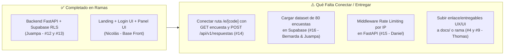

# 📊 Informe de Estado de Ramas en GitHub, Plan de Merge y Cierre del Sprint 3
## Dunk & Code XD — Proyecto ScanSayDone
> **Fecha del Informe:** Miércoles, 11 de Noviembre de 2026  
> **Repositorio:** [`DunkandCode/ScanSayDone`](https://github.com/DunkandCode/ScanSayDone)  
> **Coordinador / Product Manager:** Daniel García Rojas (`@DGRcodex`)  
> **Integrantes:** Juan Pablo Ahumada (`@JuampaCL`), Nicolás López (`@nicolaslopezv`), Bernarda Rodríguez (`@bernarda2020163`), Thomas Rain (`@thomasrain05-design`), Fabiana Cueto.

---

## 1. Resumen Ejecutivo de las Ramas en GitHub (`git fetch --all`)

Tras auditar todas las ramas remotas del repositorio, el estado actual frente a `origin/main` (commit base `433c2c8`) es el siguiente:

| Rama Remota | Responsable | Estado vs `main` | CI / GitHub Actions | Resumen del Aporte |
| :--- | :--- | :---: | :---: | :--- |
| `origin/main` | Equipo | **Actualizado (`1fafbff` + docs)** | ✅ Passing | **Fusión completada hoy (11/Nov):** Integra el Backend completo de Juampa (`dev/JuampaCL`) y el Frontend completo de Nicolás (`dev/nicolaslopezv-front`). |
| `origin/dev/JuampaCL` | Juan Pablo Ahumada | **✅ Fusionada en `main`** (`feadd0d`) | ✅ Passing (53s) | **Backend FastAPI completo (#12 y #13):** SQLAlchemy, migración Alembic con RLS en Supabase, endpoints de empresas y respuestas, NLP integrado, 11 suites de `pytest` y `vercel.json` unificado. |
| `origin/dev/nicolaslopezv-front` | Nicolás López | **✅ Fusionada en `main`** (`1fafbff`) | ✅ Passing (42s) | **Frontend completo en Next.js 16 + Tailwind 4:** Landing de 8 bandas, pantalla `/entrar`, dashboard `/panel` con gráficos SVG, activos WebP optimizados, tests unitarios (`vitest`) y de accesibilidad (`playwright` + `axe`). |
| `origin/dev/nicolaslopezv` | Nicolás López | +2 commits adelante / 7 atrás | ⚪ Supersedida | Primera importación del frontend del 05/Nov (reemplazada por `dev/nicolaslopezv-front`, que parte limpia desde `main`). |
| `origin/dev/DGRcodex` | Daniel García | 0 adelante / 4 atrás | ✅ Integrada | Ajustes de despliegue Vercel e infraestructura CI ya fusionados en `main`. |
| `origin/dev/bernarda2020163` | Bernarda Rodríguez | 0 adelante / 7 atrás | ⚪ Sin push nuevo | Sus entregables metodológicos y de datos fueron integrados vía `docs/datos/`, pero falta el push de la carga del dataset (#16). |
| `origin/dev/thomasrain05-design` | Thomas Rain | 0 adelante / 7 atrás | ⚪ Sin push nuevo | Sin commits nuevos en la rama durante el Sprint 3. |

---

## 2. Detalle Técnico de los Avances por Rama

### ⚙️ A. Rama `origin/dev/JuampaCL` — Ingeniería Backend & Base de Datos (Juan Pablo)
Juan Pablo realizó un trabajo sobresaliente de arquitectura en `scansaydone-back/` (**46 archivos modificados, +1.847 líneas**), dejando **100% resueltos los Issues #12 y #13**:
1. **Modelos y Migraciones (`alembic` + `SQLAlchemy`):**
   - Implementación del esquema relacional en `scansaydone/models.py`: tablas `dim_rubros`, `dim_empresas` y `fact_encuestas`.
   - Migración `0001_tablas_iniciales.py` aplicada en Supabase con **Row Level Security (RLS)** activado para proteger la base de datos de escrituras directas no autorizadas desde la API pública.
   - Script `scripts/seed_demo.py` que precarga los 4 negocios piloto de demostración (*Minimarket Don Lucho*, *Café Rincón Andino*, *Peluquería Estilo Sur* y *Cosmos Accesorios*).
2. **Endpoints Productivos (`scansaydone/routers/`):**
   - `GET /api/v1/empresas/{empresa_id}/encuesta`: entrega dinámicamente las 5 preguntas adaptadas al rubro del comercio.
   - `POST /api/v1/respuestas`: recibe la respuesta anónima validada con `Pydantic` (`extra="forbid"`, validación estricta de tipos y bloqueo de caracteres `NUL`), calculando automáticamente en el servidor:
     - Categoría NPS (*Promotor*, *Pasivo*, *Detractor*).
     - Regla de Alerta temprana.
     - Clasificación NLP léxica del comentario abierto (`p5_comentario`).
     - Variables temporales automáticas en zona horaria de Chile (`America/Santiago`).
3. **Suite de Pruebas Automatizadas (`pytest`) y CI:**
   - 11 archivos de test (`test_migracion.py`, `test_respuestas.py`, `test_reglas.py`, `test_nlp.py`, `test_cors.py`, etc.) corriendo sobre SQLite en memoria y agregados a `.github/workflows/ci.yml`.
4. **Despliegue Unificado (`vercel.json` en raíz):**
   - Configuró *Vercel Services* para enrutar `/api/*`, `/health` y `/docs` al servicio FastAPI y el resto del tráfico al frontend Next.js.

---

### 💻 B. Rama `origin/dev/nicolaslopezv-front` — Ingeniería Frontend & UX/UI (Nicolás)
Nicolás construyó una base de código de altísima factura técnica en `scansaydone-front/` (**115 archivos modificados, +19.377 líneas**), con estándares rigurosos de accesibilidad y diseño:
1. **Arquitectura de Rutas en Next.js 16.4.3 + React 19 + Tailwind CSS 4:**
   - `/` (**Landing completa de 8 bandas**): Hero con escena panorámica optimizada en WebP y halo radial accesible, franja de confianza, cómo funciona, canales, aplicaciones por rubro, vista previa interactiva del panel, acordeón de preguntas frecuentes y cierre.
   - `/entrar` (**Pantalla de acceso**): Interfaz de login visualmente terminada (lista para conectar a autenticación en Sprint 4).
   - `/panel` (**Dashboard del comercio**): Panel interactivo con gráficos SVG nativos sin dependencias pesadas (`distribution-chart.tsx`, `evolution-chart.tsx`, `channel-table.tsx`, `response-list.tsx`) e interruptor de datos de demostración.
   - `/e/[code]` (**Ruta de encuesta QR**): Creada como ruta marcador (`<h1>Encuesta</h1>`) lista para conectar con el formulario de 5 preguntas y el endpoint de Juampa.
2. **Calidad, Rendimiento y Accesibilidad:**
   - Conversión de todos los activos gráficos a `.webp` (reducción de peso cercana al 90%).
   - Pruebas unitarias con `Vitest` + Testing Library en cada componente y auditoría automatizada de accesibilidad WCAG con `Playwright` + `@axe-core/playwright`.
   - Documentación exhaustiva en `docs/frontend/` (`CANON.md`, `GUIA-CONTRIBUCION-FRONTEND.md`, `ESTADO-2026-11-06.md` y planos por vista).

> **Nota sobre `origin/dev/nicolaslopezv`:** Esta rama tiene solo 2 commits del 5 de noviembre y quedó obsoleta frente a `origin/dev/nicolaslopezv-front` (que sí parte del último commit de `main` y contiene los 57 commits limpios). **No se debe hacer merge de `dev/nicolaslopezv`, sino únicamente de `dev/nicolaslopezv-front`.**

---

## 3. Diagnóstico: ¿Qué Falta para Completar el Sprint 3 y Pasar al Sprint 4?



1. **Integración Frontend ↔ Backend en la Encuesta Móvil (Issue #14):**
   - Actualmente la tarjeta de encuesta vive como demo en la landing (`survey-card.tsx`) y la ruta `/e/[code]` es un marcador vacío.
   - Falta que `/e/[code]` consulte `GET /api/v1/empresas/{id}/encuesta` y envíe las 5 respuestas a `POST /api/v1/respuestas` (que ya dejó listos Juampa).
2. **Carga del Dataset de 80 Encuestas en Supabase (Issue #16 — Bernarda & Juampa):**
   - El esquema y los 4 negocios demo ya existen (`seed_demo.py`). Falta un pequeño script o corrida para poblar las 80 filas del Excel (`docs/datos/datasets/simulacion_80_encuestas.xlsx`) en la tabla `fact_encuestas` de Supabase.
3. **Middleware de Rate Limiting Anti-Spam (Issue #15 — Daniel):**
   - Juampa ya dejó lista la validación estricta de Pydantic, límite de 300 caracteres y bloqueo de caracteres nulos en P5. Solo falta añadir el limitador de peticiones por IP en `POST /api/v1/respuestas`.
4. **Sincronización de Ramas de Datos y UX/UI (`@bernarda2020163` y `@thomasrain05-design`):**
   - Sus ramas siguen en el commit de hace una semana (`03ce92b`). Necesitan hacer `git pull origin main` después del merge de hoy y subir cualquier documento o enlace de Figma pendiente.

---

## 4. Plan Paso a Paso para Hacer los Merges a `main` (Cero Conflictos Críticos)

Se realizó una simulación previa con `git merge-tree` entre `origin/dev/JuampaCL` y `origin/dev/nicolaslopezv-front`. **Ambas ramas tocaron carpetas completamente distintas** (`scansaydone-back/` vs `scansaydone-front/`), por lo que la integración es casi 100% limpia.

El **único conflicto de líneas en todo el repositorio** ocurre al final del archivo raíz `.gitignore` (Juampa agregó reglas para `.claude/` y Nicolás agregó reglas para `ENTREGA-UX-2026-10-30/` y logs), el cual se resuelve conservando ambos bloques.

### Orden Recomendado de Ejecución

#### Paso 1: Fusionar `dev/JuampaCL` en `main` (Fast-Forward limpio)
Como `origin/dev/JuampaCL` parte exactamente del último commit de `origin/main` (`433c2c8`), entra sin ningún conflicto:
```bash
git checkout main
git pull origin main
git merge origin/dev/JuampaCL --no-ff -m "merge(back): integrar backend FastAPI, Supabase RLS y tests (#12 #13)"
```

#### Paso 2: Fusionar `dev/nicolaslopezv-front` en `main`
```bash
git merge origin/dev/nicolaslopezv-front --no-ff -m "merge(front): integrar landing, login, panel y suite a11y de scansaydone-front"
```
* **Resolución del único conflicto en `.gitignore`:**
  Al hacer el merge, abrir `.gitignore` en la raíz y dejar ambos bloques al final del archivo:
  ```gitignore
  # Claude Code
  .claude/
  claude/
  CLAUDE.md
  CLAUDE.local.md
  .claude.json
  .mcp.json

  # Historical UX snapshot — previous stack, intentionally untracked
  scansaydone-front/ENTREGA-UX-2026-10-30/
  /build*.log
  /server-*.log
  /ENTREGA-UX-*.zip
  ```
* **Verificación de `vercel.json`:**
  - Conservar el `vercel.json` de raíz creado por Juampa o verificar en el Dashboard de Vercel si el proyecto sigue apuntando al Root Directory `scansaydone-front`. (Si Vercel tiene configurado `Root Directory = scansaydone-front`, conviene probar el deploy preview antes o ajustar la configuración en Vercel).

#### Paso 3: Verificación Local de CI y Push a Producción
```bash
# 1. Probar compilación y tests del Frontend
cd scansaydone-front
npm ci
npm run build
npm test -- --run

# 2. Probar tests del Backend
cd ../scansaydone-back
python3 -m pytest -v

# 3. Subir main actualizado a GitHub
cd ..
git push origin main
```

#### Paso 4: Limpieza y Actualización de las Ramas del Equipo
Una vez que `main` tenga ambos merges en verde:
1. Cerrar / deprecar `dev/nicolaslopezv` (antigua) para que Nicolás trabaje en una sola rama oficial actualizada desde `main`.
2. Cada integrante ejecuta en su computador:
   ```bash
   git checkout dev/<tu_usuario>
   git merge origin/main
   git push origin dev/<tu_usuario>
   ```
