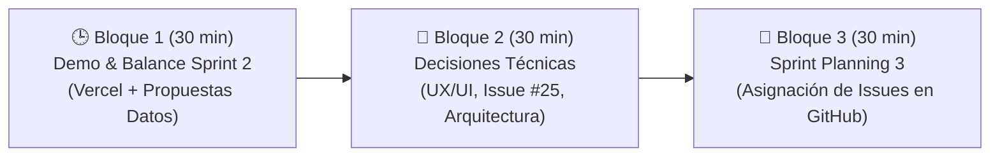

# 🚀 Guía del Coordinador: Reunión Sprint 3 (Review & Planning)
## Dunk & Code XD — Proyecto ScanSayDone
**Fecha:** Miércoles, 04 de Noviembre de 2026  
**Líder / Product Manager:** Daniel García Rojas (`@DGRcodex`)  
**Equipo:** Juan Pablo Ahumada (`@JuampaCL`), Nicolás López (`@nicolaslopezv`), Bernarda Rodríguez (`@bernarda2020163`), Thomas Rain (`@thomasrain05-design`), Fabiana Cueto.

---

## 🎯 Objetivo de la Sesión de Hoy
1. **Revisión del Sprint 2:** Demostrar el MVP en vivo en Vercel (`https://scansaydone.vercel.app`) y validar las propuestas de datos/encuestas entregadas por el equipo.
2. **Alineación Técnica:** Resolver el flujo de datos (5 preguntas cerradas), desbloquear a Juan Pablo con Supabase/Vercel (Issue #25) y encuadrar a Thomas en UX/UI.
3. **Sprint Planning 3:** Asignar y comprometer las tareas del Sprint 3 en [GitHub Projects](https://github.com/orgs/DunkandCode/projects/1) para conectar la base de datos real con el frontend.

---

## ⏱️ Dinámica de los 90 Minutos (Estructura 30 - 30 - 30)



---

## 🕒 Bloque 1: Revisión y Retrospectiva Sprint 2 (00:00 - 00:30)

### 1. El Momento "Victoria Rápida": Mostrar el Despliegue en Vivo (5 min)
* **Qué hacer:** Comparte pantalla y abre **https://scansaydone.vercel.app/**.
* **Qué decir:**  
  > *"Muchachos, antes de empezar, les muestro que el despliegue continuo en Vercel ya está 100% operativo en producción con Next.js 16 y Tailwind. El pipeline de CI en GitHub Actions está testeando cada push y ya tenemos la base interactiva de la encuesta y el dashboard visible para el público."*

### 2. Reconocimiento a los Entregables de Datos (10 min)
* **Qué se recibió:**  
  - Documento metodológico de Cuestionarios NPS y Satisfacción (4 rubros).
  - Esquema del Modelo de Datos (Data Architecture relacional `fact_encuestas`).
  - Simulación de 80 encuestas en Excel.
  - Script de Python con NLP léxico para clasificar comentarios de P5 (`codigo_integrado.py`).
  - Prototipo interactivo en Streamlit (`dashboard_opina_ya_M.py`).
* **Mensaje clave:**  
  > *"Excelente trabajo de Bernarda y Juampa con el modelo de datos y el motor de NLP. Esto nos da la regla de negocio exacta que necesitábamos para no inventar preguntas al azar."*

### 3. Mini-Retrospectiva del Sprint (15 min)
* **¿Qué salió bien?** Repo configurado, branches personales listos, Vercel online, modelo de datos definido.
* **¿Qué nos frenó?** Falta de los wireframes oficiales de UX/UI, dudas sobre variables de entorno en GitHub/Vercel.

---

## 🧠 Bloque 2: Alineación Técnica & Decisiones Clave (00:30 - 01:00)

### 🚨 Punto 1: Resolver el Estado de UX/UI (`@thomasrain05-design`)
**Diagnóstico:** Thomas aún no ha subido los wireframes finales de las Issues #4 y #9.  
**Solución para no trabar al equipo:**  
No dejar a Thomas con un requerimiento abstracto. Darle un **brief cerrado y conciso**:
1. **Encuesta QR Móvil (Issue #4):**  
   - Diseñar en Figma la pantalla móvil para las **5 preguntas oficiales definidas por Bernarda**:
     - **P1:** NPS (0 a 10 con botones táctiles grandes).
     - **P2:** Satisfacción global (1 a 5 estrellas).
     - **P3 y P4:** Atributos del rubro (1 a 5 estrellas, ej: Calidad y Rapidez).
     - **P5:** Caja de texto abierta opcional ("¿Qué podemos mejorar?").
     - **Pantalla final:** Agradecimiento post-envío en < 2 segundos.
2. **Dashboard del Comercio (Issue #9):**  
   - Tomar como referencia el prototipo Streamlit (`dashboard_opina_ya_M.py`) y plasmarlo en Figma con estilo profesional:
     - Tarjeta métrica NPS con semáforo (Verde > 50, Amarillo 0 a 50, Rojo < 0).
     - Gráfico de barras de Promotores / Pasivos / Detractores.
     - Lista de comentarios filtrados por NLP (Reclamos en rojo, Felicitaciones en verde).

---

### 🚨 Punto 2: Desbloquear a Juan Pablo — Solución a Issue #25 (GitHub Secrets vs Vercel)
**El Problema:** Juampa reportó que en cuentas de organización de GitHub no lograba configurar los Secrets para Supabase y Vercel.  
**La Solución Inmediata (Decisión Técnica):**  
1. **Vercel NO necesita secretos de GitHub para desplegar:**  
   Vercel tiene su propio gestor de variables de entorno en su panel web.  
   - Ir a: **Vercel Dashboard → Proyecto `scansaydone` → Settings → Environment Variables**.
   - Agregar allí directamente:
     ```env
     NEXT_PUBLIC_SUPABASE_URL=https://xyz.supabase.co
     NEXT_PUBLIC_SUPABASE_ANON_KEY=eyJhbGciOi...
     ```
   - ¡Listo! En el siguiente commit o redeploy, Next.js tomará las variables automáticamente sin tocar GitHub Secrets.
2. **Para el Backend en Python (FastAPI):**  
   - En local se usa `scansaydone-back/.env` (que ya está protegido en `.gitignore`).
   - Cuando despleguemos el backend en Render/Railway, las variables de conexión a Supabase (`DATABASE_URL`) se configuran en el panel de dicho proveedor.

---

### 🚨 Punto 3: Streamlit vs Next.js — Definición de Arquitectura
**Contexto:** El equipo de datos armó un dashboard muy bueno en Streamlit (`dashboard_opina_ya_M.py`).  
**Decisión a tomar en la reunión:**
* **Acuerdo de Arquitectura:**  
  - El producto comercial final de cara al cliente y al dueño del local debe ser **Next.js (`scansaydone-front`)** para garantizar un dominio único, velocidad móvil y diseño unificado.
  - El prototipo de Streamlit se mantendrá como **herramienta interna de análisis y validación rápida de datos (sandbox)** para Bernarda y Juampa.
  - Nico (`@nicolaslopezv`) y el frontend irán replicando las visualizaciones clave de Plotly en componentes React / Recharts en Next.js.

---

## 🎯 Bloque 3: Sprint Planning 3 — Compromisos en GitHub (01:00 - 01:30)

### Objetivo del Sprint 3 (04 Nov - 11 Nov)
> *"Conectar la captura de encuestas móviles con la base de datos Supabase/PostgreSQL y calcular el NPS real con el dataset de 80 respuestas."*

### Asignación de Issues en GitHub Projects:

| Issue | Tarea | Responsable Principal | Entregable Esperado |
| :-: | :--- | :--- | :--- |
| **#12** | `feat(back): Conexión a PostgreSQL (Supabase)` | **Juan Pablo (`@JuampaCL`)** | Script de migración / tablas `fact_encuestas` creadas en Supabase con credenciales en `.env`. |
| **#13** | `feat(back): Endpoints de registro de respuestas` | **Juan Pablo & Nicolás** | Endpoint `POST /api/v1/respuestas` recibiendo el payload de 5 preguntas validado con Pydantic. |
| **#14** | `feat(front): Integración de envío de respuestas` | **Nicolás (`@nicolaslopezv`)** | La encuesta en `scansaydone-front` envía el formulario al endpoint del backend o directo a Supabase. |
| **#16** | `datos: Carga de dataset sintético (80 encuestas)` | **Bernarda (`@bernarda2020163`)** | Script o carga del Excel de 80 encuestas en la base de datos para probar los reportes. |
| **#4 y #9** | `ux: Wireframes finales encuesta + dashboard` | **Thomas (`@thomasrain05-design`)** | Enlace de Figma con el flujo móvil de 5 preguntas y la pantalla de métricas. |
| **#15** | `sec: Middleware de Rate Limiting y anti-spam` | **Daniel (`@DGRcodex`)** | Protección contra spam en la API (máximo X envíos por IP/minuto) y sanitización de texto en P5. |

---

## 📁 Propuesta de Organización de Carpetas en `docs/`

Actualmente la carpeta `"docs/devops props"` tiene dos problemas:
1. Tiene un espacio en el nombre (provoca errores en markdown y terminal).
2. No es de DevOps; contiene análisis metodológico, esquema de base de datos y scripts de Python para datos.

### Estructura Recomendada:
```text
docs/
├── reuniones/              <-- Minutas y guías de reuniones semanales
│   ├── 2026-10-22_reunion_inicial.md
│   └── 2026-11-04_guia_sprint_3.md
├── datos/                  <-- (Mover aquí el contenido de "devops props")
│   ├── metodologia/        <-- Cuestionarios NPS y definición de las 5 preguntas
│   ├── arquitectura_bd/    <-- Esquema relacional y diseño de tablas
│   ├── datasets/           <-- Excel con las 80 encuestas simuladas
│   └── scripts_analitica/  <-- codigo_integrado.py y dashboard_opina_ya_M.py
├── arquitectura/           <-- Diagramas de sistema y stack
├── implementaciones/       <-- Planes maestros de MVP
├── instrucciones/          <-- Guías y protocolos de trabajo
└── roles/                  <-- Manuales y matriz por especialidad
```

---

## 💡 Sugerencias Rápidas para el Coordinador durante la Llamada
1. **Evita discusiones teóricas largas:** Si se quedan debatiendo qué gráfico poner, define: *"Usemos el diseño que ya está en Streamlit y avanzamos"*.
2. **No te vayas sin asignar los Issues:** Al minuto 80, entra a [GitHub Projects](https://github.com/orgs/DunkandCode/projects/1) y ponle nombre y apellido a cada tarjeta de Sprint 3.
3. **Cierra con una fecha de check-in intermedia:** *"El domingo a las 18:00 revisamos por Discord si hay algún bloqueo con la API o Supabase"*.
