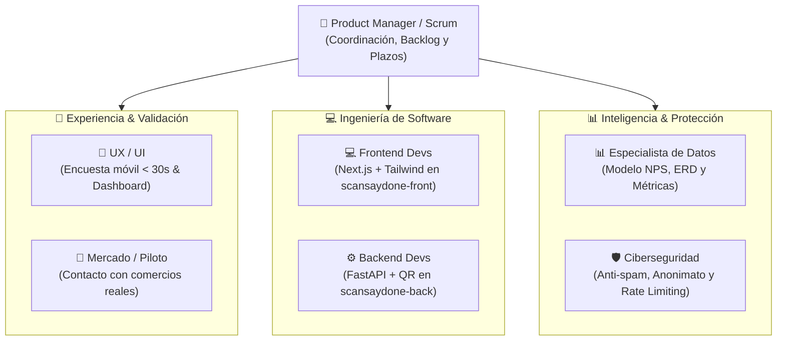

# 👥 Matriz de Roles y Asignación de Equipo
## Dunk & Code XD — Proyecto ScanSayDone

> **Instrucciones para el Product Manager / Coordinador:**  
> Esta tabla tiene los puestos listos para completar manualmente con los nombres, usuarios de GitHub y Discord de cada integrante del equipo (capacidad para 5 a 9 personas). Puedes duplicar o ajustar filas según sea necesario.

---

### 📋 Asignación de Integrantes por Área

| # | Área / Especialidad | Rol Principal | Integrante (Nombre) | Usuario GitHub | Usuario Discord |
| :-: | :--- | :--- | :--- | :--- | :--- |
| **1** | 🎯 **Gestión & Estrategia** | **Product Manager / Coordinador** | `[Por Asignar]` | `@` | `@` |
| **2** | 🎯 **Gestión & Agilidad** | **Coordinador Suplente / Scrum** | `[Por Asignar]` | `@` | `@` |
| **3** | 💻 **Ingeniería Frontend** | **Desarrollador Frontend Principal** | `[Por Asignar]` | `@` | `@` |
| **4** | 💻 **Ingeniería Frontend** | **Desarrollador Frontend / UI** | `[Por Asignar]` | `@` | `@` |
| **5** | ⚙️ **Ingeniería Backend** | **Desarrollador Backend (Python/API)** | `[Por Asignar]` | `@` | `@` |
| **6** | ⚙️ **Ingeniería Backend** | **Desarrollador Backend / Integraciones** | `[Por Asignar]` | `@` | `@` |
| **7** | 📊 **Analítica & Datos** | **Especialista de Datos & Métricas NPS**| `[Por Asignar]` | `@` | `@` |
| **8** | 🎨 **Diseño de Experiencia**| **Diseñador UX/UI & Prototipos** | `[Por Asignar]` | `@` | `@` |
| **9** | 🛡️ **Seguridad & Calidad** | **Especialista en Ciberseguridad & QA** | `[Por Asignar]` | `@` | `@` |

---

### 🧭 Resumen de Responsabilidades por Función

---

### 📚 Guías Detalladas por Función
Cada integrante tiene una guía paso a paso con las tecnologías, entregables y comandos para empezar a trabajar de inmediato:

- 🎯 **[Guía de Product Manager / Coordinación](00_product_manager.md)**
- 💻 **[Guía de Desarrollo Frontend](01_frontend.md)**
- ⚙️ **[Guía de Desarrollo Backend](02_backend.md)**
- 📊 **[Guía de Datos & Analytics](03_datos.md)**
- 🎨 **[Guía de UX / UI Design](04_ux_ui.md)**
- 🛡️ **[Guía de Ciberseguridad & QA](05_ciberseguridad.md)**
