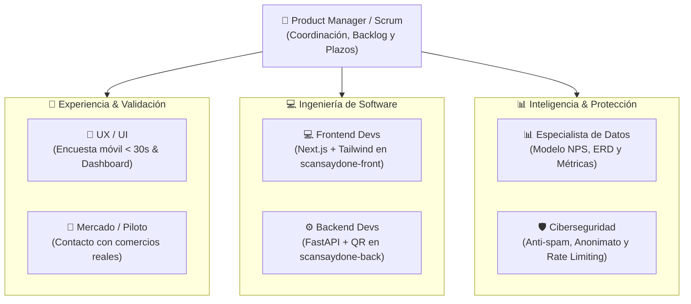

# 👥 Matriz de Roles y Asignación de Equipo
## Dunk & Code XD — Proyecto ScanSayDone

> **Estado de la matriz:**  
> Asignación oficial basada en la ficha de equipo ([`docs/equipo-dunk-code-xd.png`](../equipo-dunk-code-xd.png)), historial de commits, GitHub Issues y minutas semanales. Los campos marcados como `[Por confirmar]` corresponden a cuentas de Discord/GitHub o roles aún por ratificar en reunión.

---

### 📋 Asignación de Integrantes por Área

| # | Área / Especialidad | Rol Principal | Integrante (Nombre) | Usuario GitHub | Usuario Discord |
| :-: | :--- | :--- | :--- | :--- | :--- |
| **1** | 🎯 **Gestión & Estrategia** | **Product Manager / Coordinador Principal** | **Daniel García Rojas** | [`@DGRcodex`](https://github.com/DGRcodex) | `@D.G.R.` |
| **2** | 🎯 **Gestión & Agilidad** | **Coordinación Suplente / Scrum** | **Nicolás López Vásquez** · **Bernarda Rodríguez** · **Juan Pablo Ahumada** | [`@nicolaslopezv`](https://github.com/nicolaslopezv) · [`@bernarda2020163`](https://github.com/bernarda2020163) · [`@JuampaCL`](https://github.com/JuampaCL) | `@nicolopezvasquez1623` · `@bernarda_rodriguez_81811` · `@juampacl` |
| **3** | 💻 **Ingeniería Frontend** | **Desarrollador Frontend Principal** (`scansaydone-front`) | **Nicolás López Vásquez** | [`@nicolaslopezv`](https://github.com/nicolaslopezv) | `@nicolopezvasquez1623` |
| **4** | ⚙️ **Ingeniería Backend** | **Desarrollador Backend Principal** (`scansaydone-back`) | **Juan Pablo Ahumada** | [`@JuampaCL`](https://github.com/JuampaCL) | `@juampacl` |
| **5** | 📊 **Analítica & Datos** | **Especialista de Datos & Métricas NPS** *(Apoyo ERD/ETL: Juan Pablo Ahumada)* | **Bernarda Rodríguez** | [`@bernarda2020163`](https://github.com/bernarda2020163) | `@bernarda_rodriguez_81811` |
| **6** | 🎨 **Diseño de Experiencia** | **Diseñador UX/UI & Prototipos** | **Thomas Rain** | [`@thomasrain05-design`](https://github.com/thomasrain05-design) | `@partypankakes12` |
| **7** | 🎨 **Diseño de Experiencia** | **Diseñador UX/UI** | **Adrián** *(`[Apellido por confirmar]`)* | [`@adrianoux8`](https://github.com/adrianoux8) | `[Por confirmar]` |
| **8** | 🛡️ **Seguridad & Calidad** | **Especialistas en Ciberseguridad, CI/CD & QA** | **Daniel García Rojas** · **Juan Pablo Ahumada** | [`@DGRcodex`](https://github.com/DGRcodex) · [`@JuampaCL`](https://github.com/JuampaCL) | `@D.G.R.` · `@juampacl` |
| **9** | 📢 **Mercado & Pilotos** | **Validación Comercial y Comercios Piloto** | **Fabiana Cueto** | `[Por confirmar]` | `@fabianzd` |
| **10** | 🤝 **Equipo Dunk & Code XD** | **Integrante** *(Rol específico por confirmar)* | **Sebastián Riveros** | `[Por confirmar]` | `[Por confirmar]` |

---

### 🧭 Resumen de Responsabilidades por Función

---

### 📚 Guías Detalladas por Función
Cada integrante tiene una guía paso a paso con las tecnologías, entregables y comandos para empezar a trabajar de inmediato:

- 🎯 **[Guía de Product Manager / Coordinación](00_product_manager.md)**
- 💻 **[Guía de Desarrollo Frontend](01_frontend.md)**
- ⚙️ **[Guía de Desarrollo Backend](02_backend.md)**
- 📊 **[Guía de Datos & Analytics](03_datos.md)**
- 🎨 **[Guía de UX / UI Design](04_ux_ui.md)**
- 🛡️ **[Guía de Ciberseguridad & QA](05_ciberseguridad.md)**
